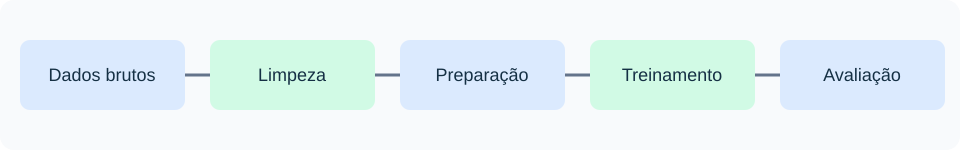

# Aula 00 — Preparação do ambiente e estrutura do SaudeIA

**Projeto:** SaudeIA — Machine Learning aplicado à classificação experimental  
**Objetivo:** clonar o projeto, preparar o ambiente Python e verificar os dados.  
**Pré-requisitos:** Python, VSCode e Git estudados no EngConvert e no Flappy Bird.

> **Uso educacional:** o SaudeIA é um exemplo de classificação experimental; não realiza diagnóstico médico nem deve orientar decisões de saúde.

## 1. Visão geral

Vamos preparar dados, treinar e avaliar um modelo de Machine Learning e integrá-lo a uma aplicação web. Embora o exemplo central utilize descrições de sintomas, as técnicas de tratamento e classificação também se aplicam a dados de engenharia, como vibração e falhas de equipamentos.



## 2. Clonar o repositório oficial

No **PowerShell integrado ao VSCode**, execute:

```powershell
New-Item -ItemType Directory -Force C:\Projetos | Out-Null
cd C:\Projetos
git clone https://github.com/wilson-luciano/saudeia.git SaudeIA
cd SaudeIA
code .
```

O `git clone` cria automaticamente a pasta `C:\Projetos\SaudeIA`; não é necessário criá-la antes. O repositório no GitHub chama-se `saudeia`, e adotaremos `SaudeIA` como nome da pasta local.

> **Clone e Fork:** `clone` baixa uma cópia do repositório para o computador; *fork* cria uma cópia na conta GitHub de outra pessoa. Nesta disciplina, basta clonar. Não faremos fork.

### Se ocorrer erro na clonagem

| Mensagem ou situação | O que fazer |
|---|---|
| `git: command not found` | Verifique se o Git está instalado e reinicie o terminal do VSCode. |
| `Repository not found` | Confira o endereço do repositório e se ele já está público. Abra `https://github.com/wilson-luciano/saudeia` no navegador. |
| `destination path 'SaudeIA' already exists and is not an empty directory` | A pasta já existe. **Não a apague sem conferir seu conteúdo.** Se o projeto já foi clonado, entre nela com `cd C:\Projetos\SaudeIA` e abra `code .`. |
| `Could not resolve host: github.com` ou falha de conexão | Verifique a internet e tente novamente. |
| `code: command not found` | Abra o VSCode manualmente e use **Arquivo → Abrir Pasta** para selecionar `C:\Projetos\SaudeIA`. |

**Verificação rápida:** no PowerShell, execute `pwd` e `ls`. O caminho deverá ser `C:\Projetos\SaudeIA`, e os arquivos do projeto deverão aparecer. Se o erro continuar, copie a mensagem completa do terminal e apresente ao professor; não repita comandos que possam sobrescrever arquivos.

## 3. Criar e ativar o ambiente virtual

Abra o terminal **PowerShell** do VSCode na pasta do projeto:

```powershell
py -3.12 -m venv .venv
.\.venv\Scripts\Activate.ps1
python -m pip install --upgrade pip
python -m pip install -r requirements.txt
```

**Atenção:** o arquivo `requirements.txt` deve estar salvo em **UTF-8** para garantir a leitura correta pelo `pip`. A instalação das bibliotecas não exige uma chave da OpenAI; essa chave será necessária apenas para utilizar as funcionalidades de conversa com o serviço externo.

Com a ativação, o terminal deverá mostrar `(.venv)` antes do caminho. Nesse estado, `python` e `pip` utilizam o ambiente virtual do projeto.

Se a ativação for bloqueada pela política do PowerShell, execute **somente no terminal atual**:

```powershell
Set-ExecutionPolicy -Scope Process -ExecutionPolicy Bypass
.\.venv\Scripts\Activate.ps1
```

Se `py -3.12` não funcionar, verifique as instalações com `py -0p`. No VSCode, selecione o interpretador `.venv` em **Python: Select Interpreter**, se necessário.

**Verifique as bibliotecas:**

```powershell
python -c "import pandas, sklearn, xgboost, fastapi; print('Ambiente SaudeIA OK')"
```

Resultado esperado: `Ambiente SaudeIA OK`.

## 4. Estrutura do projeto

| Pasta/arquivo | Função |
|---|---|
| `aulas/` | Roteiros práticos |
| `dados/brutos/` | Dados originais, que não devem ser alterados |
| `dados/processados/` | Dados tratados para o treinamento |
| `services/` | Módulos Python do projeto |
| `model/` | Modelos treinados |
| `templates/` e `static/` | Interface web |
| `assets/` | Diagramas e imagens das aulas |
| `tests/` | Testes automatizados |
| `README.md` e `LICENSE` | Documentação e licença MIT |
| `.gitignore` e `.env.example` | Regras de exclusão do Git e modelo de configuração |

A configuração da chave da API OpenAI será abordada na **Aula 04**, durante a implementação da aplicação web e da integração com o assistente de IA. A chave poderá ser configurada por variável de ambiente ou por arquivo `.env`, sem incluir credenciais no GitHub.

## 5. Testar a presença dos dados

No PowerShell, com a `.venv` ativada:

```powershell
python -c "from pathlib import Path; p=Path('dados/brutos/dados_originais.csv'); print('Arquivo encontrado:', p.is_file()); print('Tamanho (bytes):', p.stat().st_size if p.is_file() else 0)"
```

**Resultado esperado:** `Arquivo encontrado: True` e tamanho maior que zero. A inspeção e a limpeza dos dados começarão na Aula 01.

## 6. Conferência final

- [ ] Projeto clonado em `C:\Projetos\SaudeIA`.
- [ ] Ambiente `.venv` criado e ativado.
- [ ] Dependências instaladas e verificadas.
- [ ] Dados brutos localizados.

**Próxima aula:** Aula 01 — Leitura, inspeção, tratamento e limpeza de dados.


---

# 7. PROJETO AVALIATIVO 3 — CRITÉRIOS, APRESENTAÇÃO E ENTREGA

> **ATIVIDADE AVALIATIVA — VALOR: 10,0 PONTOS**  
> Desenvolvimento, documentação, apresentação e demonstração de uma aplicação de Machine Learning.

### 7.1. Objetivo

Desenvolver, testar, documentar e apresentar uma aplicação de Machine Learning que transforme dados brutos em informações úteis. O SaudeIA, que classifica descrições textuais de sintomas, é o exemplo orientador; a equipe poderá adaptar a solução para problemas de Engenharia Mecânica, como classificação de falhas por vibração, temperatura, pressão ou registros de manutenção.

A equipe deverá demonstrar o fluxo **dados brutos → limpeza e preparação → características → treinamento → avaliação → modelo salvo → predição → aplicação**. Para textos, pode usar TF-IDF; para dados numéricos, deve empregar características e tratamento adequados ao problema.

### 7.2. Desenvolvimento e resultados esperados

- Utilizar um conjunto de dados identificado e documentar sua origem, características e limitações. Um novo dataset ou aplicação própria será valorizado no critério de originalidade.
- Identificar e tratar valores ausentes, duplicatas e inconsistências, justificando as decisões. Não excluir automaticamente medições extremas que possam indicar defeitos reais.
- Separar treinamento e teste antes de ajustar transformações aprendidas com os dados, evitando vazamento de informação.
- Treinar um modelo de classificação ou predição, apresentar métricas adequadas e discutir erros e limitações. No SaudeIA, podem ser usadas acurácia, precisão, recall, F1-score e matriz de confusão.
- Salvar e carregar o modelo; executar previsões com novas entradas; apresentar interface ou API funcional.
- Explicar o código, as bibliotecas e as contribuições próprias. O SaudeIA é experimental e não realiza diagnóstico médico validado.

### 7.3. Organização da equipe e arquivos

Identifique a pasta e os arquivos usando **somente o primeiro nome de cada integrante**, no padrão:

`PPEM Python – Aluno1-Aluno2-Aluno3 – Projeto 3 – 26.2`

Exemplo:

```text
PPEM Python – João-Maria-Lucas – Projeto 3 – 26.2/
├── PPEM Python – João-Maria-Lucas – Projeto 3 – 26.2 – Relatorio.pdf
├── PPEM Python – João-Maria-Lucas – Projeto 3 – 26.2 – Apresentacao.pptx
└── PPEM Python – João-Maria-Lucas – Projeto 3 – 26.2 – Codigo.zip
```

O `Codigo.zip` deve incluir código-fonte, dados cuja redistribuição seja permitida (ou instruções de obtenção), `README.md`, `requirements.txt`, `LICENSE` e arquivos necessários à execução. **Não incluir** `.venv/`, `__pycache__/`, chaves de API, `.env` com credenciais ou dados pessoais. O programa será demonstrado em execução no ambiente Python; não se exige `.exe` para uma aplicação web FastAPI. Caso a equipe produza um executável, poderá demonstrá-lo como incremento.

### 7.4. Relatório técnico e apresentação

O **relatório em PDF** deve conter: capa (nomes completos, matrículas, turma e período), sumário, introdução, objetivos, descrição do problema, origem e descrição do dataset, limpeza e preparação dos dados, técnicas e bibliotecas, arquitetura, treinamento, métricas, resultados e testes, limitações, incrementos da equipe, conclusão e referências. Inclua capturas de tela e explique trechos importantes; evite páginas de código sem análise.

A **apresentação em PowerPoint** deve sintetizar problema, dados, pipeline, modelo, avaliação, interface, testes e melhorias. Todos os integrantes devem estar preparados para demonstrar a aplicação e responder perguntas. Os slides não substituem a demonstração funcional.

### 7.5. Critérios de avaliação — 10,0 pontos

A avaliação considera o desenvolvimento técnico, a documentação, a originalidade e a apresentação do projeto. **A apresentação em PowerPoint e a demonstração funcional valem 2,0 pontos.**

| Nº | Critério | Pontos |
|---|---|---:|
| 1 | Identificação correta da pasta e dos arquivos de entrega | 0,5 |
| 2 | Relatório técnico completo, com metodologia, resultados e conclusão | 1,0 |
| 3 | Explicação do projeto, dos dados, das variáveis, do modelo e dos parâmetros | 0,5 |
| 4 | Originalidade, novo dataset ou aplicação própria, complexidade e criatividade | 0,5 |
| 5 | Estrutura, lógica, legibilidade e boas práticas do código | 1,0 |
| 6 | Pipeline de ML: limpeza, preparação, vetorização quando pertinente, treinamento, avaliação e persistência | 1,5 |
| 7 | Compreensão de funções, classes, métodos, objetos e organização do programa | 0,5 |
| 8 | Robustez: erros de leitura, entradas inválidas, ausência de modelo e limitações | 0,5 |
| 9 | Documentação: README, bibliotecas, requirements e instruções de execução | 0,5 |
| 10 | Incrementos efetivamente implementados além do exemplo didático | 1,0 |
| 11 | **Apresentação em PowerPoint e demonstração funcional** | **2,0** |
| 12 | Bibliografia e créditos de dados, recursos e ferramentas utilizados | 0,5 |
| **Total** | | **10,0** |

**Distinção:** o critério 4 valoriza a originalidade da proposta/dataset; o critério 10 exige funcionalidades ou melhorias efetivamente implementadas. Uma proposta criativa não substitui sua implementação.

### 7.6. Prazo, apresentação e descontos

- Entrega após a data e hora estabelecidas: **–0,5 ponto por dia de atraso**.
- Seminário após a data estipulada: **–1,0 ponto por dia de aula de atraso**.
- Não apresentação do trabalho ou ausência na apresentação: **–2,0 pontos**.

### 7.7. Entrega e conferência

Enviar os arquivos digitais para **wilsonluciano@yahoo.com.br**, conforme as orientações do professor. O repositório oficial é apenas a fonte do material; cada equipe trabalha localmente e, se publicar no GitHub, utiliza seu próprio repositório. Informe o link no envio, quando houver.

Antes de entregar, verifique se o relatório e os slides abrem, se o ZIP contém o código completo e se o programa pode ser executado em uma pasta extraída, com as dependências instaladas.

### 7.8. Checklist final

- [ ] Arquivos e pasta identificados no padrão do Projeto 3.
- [ ] Dados brutos e processados, origem e tratamento documentados.
- [ ] Treinamento, avaliação, persistência e predição demonstrados.
- [ ] Interface/API funcional e tratamento de erros verificados.
- [ ] Relatório PDF, apresentação PPTX e código ZIP conferidos.
- [ ] README, requirements, LICENSE e referências incluídos.
- [ ] Incrementos próprios e limitações explicados.
- [ ] Nenhuma chave, dado pessoal ou arquivo temporário incluído.
- [ ] Entrega realizada dentro do prazo informado.

---

**Licença:** MIT, conforme `LICENSE`. Material didático de programação e Machine Learning, sem finalidade clínica.

© 2026 **Wilson Luciano** · Programação para Engenharia Mecânica · DMEC · UFS · SaudeIA — Inteligência Artificial Aplicada à Engenharia · Material didático · Versão 1.0
