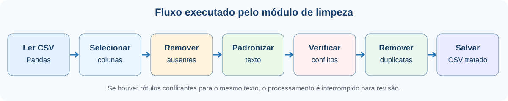
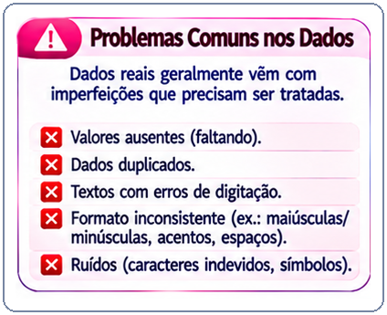
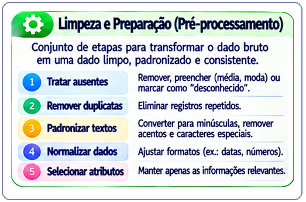
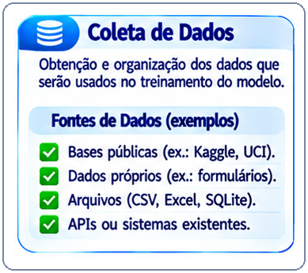
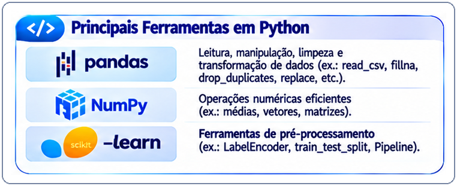
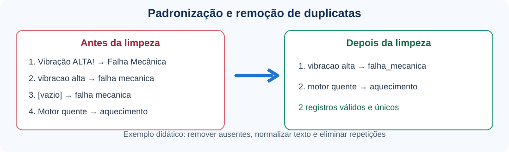
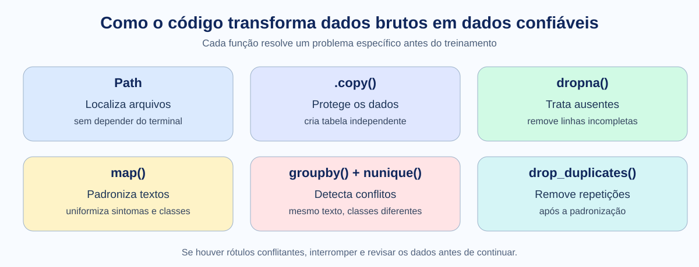
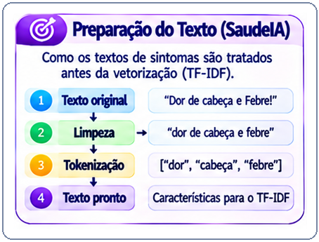
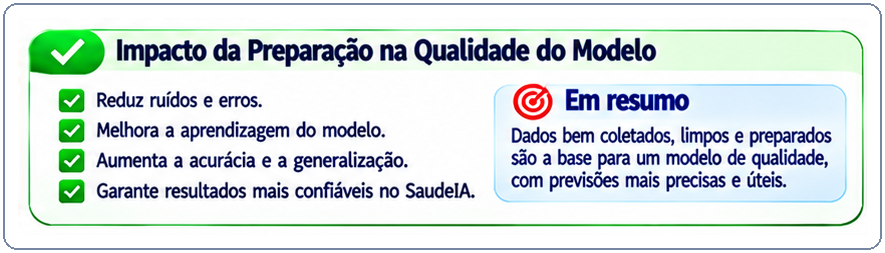

# Aula 01 — Leitura, Tratamento e Limpeza de Dados

**Disciplina:** Programação para Engenharia Mecânica — 2026.2  
**Projeto Avaliativo 3:** SaudeIA — Inteligência Artificial Aplicada à Engenharia  
**Ambiente:** Windows · VSCode · PowerShell · Python 3.12 · Pandas

> **Uso exclusivamente didático.** Os rótulos do conjunto de dados não constituem diagnósticos médicos. As técnicas também podem ser aplicadas a registros de manutenção, vibração e falhas mecânicas.

## 1. Objetivo e resultado esperado

Nesta aula, vamos **ler, inspecionar, padronizar e limpar** o arquivo `dados/brutos/dados_originais.csv` sem modificá-lo. Ao final, produziremos `dados/processados/dataset_limpo.csv` e um relatório de qualidade no terminal.

**Fluxo:** dados brutos → inspeção → seleção de colunas → padronização → verificação de inconsistências → remoção de duplicatas → CSV tratado.

<p align="center">
  
</p>

<p align="center">
  <em>Figura 1 — Sequência de operações que será implementada nesta aula. A transformação TF-IDF ocorrerá na Aula 02.</em>
</p>

## 2. Conceitos essenciais

| Conceito | Significado prático |
|---|---|
| `DataFrame` | Tabela de dados manipulada pelo Pandas. |
| Valor ausente | Informação não preenchida ou texto vazio. |
| Duplicata | Registro repetido, que pode distorcer a avaliação do modelo. |
| Padronização | Uniformizar letras, espaços, pontuação e rótulos. |
| Inconsistência | Mesmo texto associado a rótulos diferentes; exige investigação. |
| Vazamento de dados | Uso indevido de informações do teste durante o treinamento ou a preparação. |

<p align="center">
  
</p>

<p align="center">
  <em>Figura 2 — Problemas a investigar antes de treinar o modelo: ausentes, duplicatas e inconsistências.</em>
</p>

<p align="center">
  
</p>

<p align="center">
  <em>Figura 3 — O tratamento prepara os registros para uso confiável. Nem todas as técnicas se aplicam igualmente a todos os datasets.</em>
</p>

**Atenção:** uma medição extrema de temperatura ou vibração não deve ser excluída automaticamente: pode representar uma falha real. Nesta aula, trabalharemos com textos; no Projeto 3, a equipe deverá justificar o tratamento de seu próprio dataset.

## 3. Abrir o projeto e verificar o arquivo

<p align="center">
  
</p>

<p align="center">
  <em>Figura 4 — Dados podem vir de bases públicas, medições próprias, arquivos ou sistemas existentes. Aqui utilizaremos um CSV já distribuído.</em>
</p>

No **PowerShell integrado ao VSCode**:

```powershell
cd C:\Projetos\SaudeIA
.\.venv\Scripts\Activate.ps1
python -c "import pandas as pd; print('Pandas:', pd.__version__)"
```

Confira a existência do arquivo original:

```powershell
Test-Path .\dados\brutos\dados_originais.csv
```

**Resultado esperado:** `True`. Caso apareça `False`, confira a pasta aberta e a clonagem do projeto.

## 4. Conhecer o dataset antes de alterá-lo

<p align="center">
  
</p>

<p align="center">
  <em>Figura 5 — Pandas será usado para ler e limpar a tabela; NumPy e scikit-learn aparecerão em outras etapas do projeto.</em>
</p>

Execute:

```powershell
python -c "import pandas as pd; d=pd.read_csv('dados/brutos/dados_originais.csv'); print('Dimensões:',d.shape); print('Colunas:',d.columns.tolist()); print(d.head(3).to_string(index=False)); print('Ausentes:',d.isna().sum().to_dict()); print('Duplicatas exatas:',d.duplicated().sum())"
```

Na base didática distribuída nesta versão, a inspeção inicial indica **300 registros e 4 colunas**: `sintomas_texto`, `diagnostico`, `sintomas_limpo` e `diagnostico_limpo`. O arquivo contém textos originais e versões já normalizadas; **vamos partir das colunas `sintomas_limpo` e `diagnostico_limpo`** para praticar a construção de um pipeline reproduzível. Os totais podem variar se o dataset for atualizado.

> **Por que não usar as quatro colunas como entrada do modelo?** Porque `diagnostico` e `diagnostico_limpo` representam a resposta (rótulo), não características disponíveis em uma nova consulta. O modelo receberá o texto dos sintomas e tentará prever o rótulo.

### Exemplo visual — Antes e depois

<p align="center">
  
</p>

<p align="center">
  <em>Figura 6 — Exemplo coerente com o código: a linha sem sintomas é excluída, as grafias equivalentes são padronizadas e a duplicata resultante é removida. Não se inventam valores ausentes.</em>
</p>

## 5. Criar o módulo de limpeza

No terminal **PowerShell integrado ao VSCode**, na raiz do projeto `C:\Projetos\SaudeIA`, crie a pasta (se necessário), crie o arquivo (somente se ainda não existir) e abra-o no editor:

```powershell
New-Item -ItemType Directory -Force services | Out-Null
if (-not (Test-Path services\limpeza_dados.py)) { New-Item -ItemType File services\limpeza_dados.py | Out-Null }
code services\limpeza_dados.py
```

**Alternativa manual:** no Explorador do VSCode, clique com o botão direito na pasta `services`, selecione **New File** e informe `limpeza_dados.py`. Caso a pasta não exista, crie-a antes com **New Folder**.

> **Observação:** o teste `Test-Path` evita recriar um arquivo que já exista, preservando seu conteúdo.

Copie o código completo abaixo. **Os comentários explicam o objetivo de cada etapa e as decisões importantes:**

```python
"""Aula 01 — preparação reproduzível dos dados do SaudeIA.

O arquivo original permanece intacto. A saída é um novo CSV tratado.
"""

from pathlib import Path  # Caminhos de arquivos, sem depender do terminal atual.
import re                 # Expressões regulares para limpar caracteres e espaços.
import unicodedata        # Permite separar letras de sinais de acentuação.

import pandas as pd       # Biblioteca para trabalhar com tabelas (DataFrames).


# __file__ é o caminho deste script; parents[1] é a raiz do SaudeIA.
# Assim, o programa funciona mesmo se o terminal estiver em outra pasta.
RAIZ = Path(__file__).resolve().parents[1]
ORIGEM = RAIZ / "dados" / "brutos" / "dados_originais.csv"
DESTINO = RAIZ / "dados" / "processados" / "dataset_limpo.csv"


def normalizar_texto(valor: str) -> str:
    """Transforma um texto em letras minúsculas, sem acentos ou pontuação."""
    # NFKD separa a letra do acento: "ã" passa a "a" + sinal de til.
    texto = unicodedata.normalize("NFKD", str(valor))

    # Retira os sinais combinantes (acentos) e conserva as letras.
    texto = "".join(c for c in texto if not unicodedata.combining(c))

    # Padroniza maiúsculas/minúsculas e retira espaços nas extremidades.
    texto = texto.lower().strip()

    # Substitui pontuação por espaços, preservando letras e números.
    texto = re.sub(r"[^a-z0-9\s]", " ", texto)

    # Troca sequências de espaços por um único espaço.
    return re.sub(r"\s+", " ", texto).strip()


def normalizar_rotulo(valor: str) -> str:
    """Padroniza a classe: 'Falha Mecânica' -> 'falha_mecanica'."""
    return normalizar_texto(valor).replace(" ", "_")


def preparar_dados(origem: Path = ORIGEM) -> tuple[pd.DataFrame, dict]:
    """Devolve a tabela limpa e um dicionário com indicadores de qualidade."""
    # Interrompe a execução com mensagem clara se o arquivo não existir.
    if not origem.is_file():
        raise FileNotFoundError(f"Arquivo não encontrado: {origem}")

    # Carrega o CSV em memória; o arquivo bruto não será regravado.
    bruto = pd.read_csv(origem, encoding="utf-8")

    # Confere as duas colunas necessárias: entrada (texto) e saída (classe).
    colunas = {"sintomas_limpo", "diagnostico_limpo"}
    faltantes = colunas - set(bruto.columns)
    if faltantes:
        raise ValueError(f"Colunas ausentes: {sorted(faltantes)}")

    # Seleciona apenas as colunas úteis e cria uma cópia independente.
    dados = bruto[["sintomas_limpo", "diagnostico_limpo"]].copy()
    dados.columns = ["sintomas", "diagnostico"]
    total_inicial = len(dados)  # Quantidade antes do tratamento.

    # Remove linhas sem sintomas ou diagnóstico (valores NaN).
    # É importante fazer isso ANTES de converter valores para texto.
    dados = dados.dropna(subset=["sintomas", "diagnostico"])

    # map() executa a função de normalização em cada célula da coluna.
    dados["sintomas"] = dados["sintomas"].map(normalizar_texto)
    dados["diagnostico"] = dados["diagnostico"].map(normalizar_rotulo)

    # Exclui também campos que ficaram vazios após a limpeza.
    dados = dados[(dados["sintomas"] != "") & (dados["diagnostico"] != "")]
    apos_validacao = len(dados)

    # Conta quantos diagnósticos distintos aparecem para cada texto.
    # Um texto associado a duas classes precisa de revisão humana.
    ambiguos = dados.groupby("sintomas")["diagnostico"].nunique()
    quantidade_ambiguos = int((ambiguos > 1).sum())
    if quantidade_ambiguos:
        exemplos = ambiguos[ambiguos > 1].index.tolist()[:3]
        raise ValueError(
            f"Encontrados {quantidade_ambiguos} textos com rótulos conflitantes. "
            f"Revise os dados. Exemplos: {exemplos}"
        )

    # Remove pares idênticos (mesmos sintomas e mesmo diagnóstico).
    antes_duplicatas = len(dados)
    dados = dados.drop_duplicates(subset=["sintomas", "diagnostico"])

    # Recria o índice sequencial após as exclusões (0, 1, 2, ...).
    dados = dados.reset_index(drop=True)

    # Guarda os números para o relatório de qualidade do dataset.
    indicadores = {
        "registros_brutos": total_inicial,
        "removidos_ausentes_ou_vazios": total_inicial - apos_validacao,
        "duplicatas_removidas": antes_duplicatas - len(dados),
        "registros_finais": len(dados),
        "classes": dados["diagnostico"].nunique(),
    }
    return dados, indicadores


def main() -> None:
    """Executa a limpeza, salva o resultado e apresenta o relatório."""
    dados, indicadores = preparar_dados()

    # Cria a pasta de saída se ela ainda não existir.
    DESTINO.parent.mkdir(parents=True, exist_ok=True)

    # Salva somente a tabela tratada; não modifica dados_originais.csv.
    dados.to_csv(DESTINO, index=False, encoding="utf-8")

    # Exibe um resumo que permite conferir a execução no terminal.
    print("=== RELATÓRIO DE QUALIDADE — SAUDEIA ===")
    for nome, valor in indicadores.items():
        print(f"{nome}: {valor}")
    print(f"Arquivo gerado: {DESTINO}")
    print("\nAmostra tratada:")
    print(dados.head(3).to_string(index=False))


# Executa main() somente quando este arquivo é chamado diretamente.
# Se outro módulo importar suas funções, a limpeza não roda sozinha.
if __name__ == "__main__":
    main()
```

### Resumo visual — Por que cada operação é necessária?

<p align="center">
  
</p>

<p align="center">
  <em>Figura 7 — Relação entre as operações do Pandas e os problemas que elas resolvem.</em>
</p>

**Entenda as decisões:** `Path` localiza os arquivos; `.copy()` protege a tabela original em memória; `dropna()` remove registros sem campos obrigatórios; `map()` padroniza os textos; `groupby().nunique()` identifica rótulos conflitantes, que exigem revisão; `drop_duplicates()` remove repetições exatas depois da padronização. A verificação de conflitos ocorre **antes** da remoção das duplicatas para não esconder problemas de rotulagem.

<p align="center">
  
</p>

<p align="center">
  <em>Figura 8 — O texto é padronizado antes de ser convertido em características numéricas. A tokenização e a vetorização serão aprofundadas na Aula 02.</em>
</p>

> **Importante:** a normalização aqui é textual. A vetorização TF-IDF, que transforma texto em números para o modelo, será estudada na Aula 02.

## 6. Executar e conferir

<p align="center">
  
</p>

<p align="center">
  <em>Figura 9 — Dados consistentes ajudam a produzir resultados mais confiáveis; melhorias de acurácia não são garantidas e devem ser verificadas na avaliação.</em>
</p>

**Importante:** o repositório didático já pode conter `dados/processados/dataset_limpo.csv`. Antes de executar o script, preserve uma cópia desse arquivo, caso queira comparar o resultado:

```powershell
Copy-Item .\dados\processados\dataset_limpo.csv .\dados\processados\dataset_limpo_anterior.csv -ErrorAction SilentlyContinue
```

Execute:

```powershell
python .\services\limpeza_dados.py
```

O programa deverá mostrar o relatório de qualidade e salvar o CSV tratado. **Os números exatos devem ser lidos no seu terminal**, pois dependem do conteúdo do arquivo distribuído.

Confirme o resultado:

```powershell
python -c "import pandas as pd; d=pd.read_csv('dados/processados/dataset_limpo.csv'); print('Dimensões:',d.shape); print('Ausentes:',d.isna().sum().sum()); print('Duplicatas:',d.duplicated().sum()); print('Classes:',d['diagnostico'].nunique())"
```

**Critérios de aceitação:** o arquivo existe; contém apenas `sintomas` e `diagnostico`; não possui campos obrigatórios vazios nem duplicatas exatas; o script pode ser executado novamente e produzir o mesmo resultado para o mesmo arquivo bruto.

## 7. Exercício prático — teste de qualidade

Sem alterar o dataset original, crie `tests/test_limpeza_dados.py` pelo terminal PowerShell integrado ao VSCode:

```powershell
New-Item -ItemType Directory -Force tests | Out-Null
if (-not (Test-Path tests\test_limpeza_dados.py)) { New-Item -ItemType File tests\test_limpeza_dados.py | Out-Null }
code tests\test_limpeza_dados.py
```

**Alternativa manual:** no Explorador do VSCode, crie a pasta `tests`, se necessário, e depois o arquivo `test_limpeza_dados.py`. O comando com `Test-Path` evita recriar um arquivo existente.

Copie o código dos testes, que contém comentários explicando cada verificação:

```python
# Importa as funções que serão verificadas pelos testes automatizados.
from services.limpeza_dados import normalizar_rotulo, normalizar_texto, preparar_dados


def test_normalizar_texto():
    # Confere remoção de acentos, pontuação e espaços extras.
    assert normalizar_texto("  Vibração,   ALTA! ") == "vibracao alta"


def test_normalizar_rotulo():
    # Verifica a conversão do nome da classe para identificador padronizado.
    assert normalizar_rotulo("Falha Mecânica") == "falha_mecanica"


def test_dataset_tratado():
    # Executa a limpeza em memória, sem gravar sobre o arquivo original.
    dados, indicadores = preparar_dados()
    # Verifica colunas, ausentes, duplicatas e consistência do relatório.
    assert list(dados.columns) == ["sintomas", "diagnostico"]
    assert not dados.isna().any().any()
    assert not dados.duplicated().any()
    assert (dados["sintomas"].str.len() > 0).all()
    assert indicadores["registros_finais"] == len(dados)
```

Execute na raiz do projeto:

```powershell
python -m pytest -q
```

**Resultado esperado:** os três testes passam. Se houver erro, leia o nome do teste e a mensagem antes de modificar o código.

## 8. Desafio de Engenharia Mecânica

Imagine um CSV com `vibracao_mm_s`, `temperatura_c` e `falha`. Discuta com sua equipe: uma vibração de 25 mm/s é necessariamente um erro de digitação? O que acontece se uma medição estiver ausente? É correto normalizar os dados usando a média de todo o conjunto antes de separar treino e teste?

**Resposta orientadora:** não descarte extremos sem justificativa; investigue valores ausentes; estatísticas aprendidas dos dados (como médias e desvios para escalonamento) devem ser ajustadas **somente no treinamento** e depois aplicadas ao teste. Na próxima aula, veremos essa separação e o treinamento do modelo.

## 9. Registro e entrega da etapa

Confira os arquivos criados ou atualizados:

```text
SaudeIA/
├── aulas/
│   └── aula-01-tratamento-limpeza-dados.md
├── assets/
│   ├── diagramas/
│   │   ├── antes-depois-limpeza.svg
│   │   └── decisoes-limpeza-dados.svg
│   ├── fluxogramas/
│   │   └── fluxo-limpeza-dados.svg
│   └── imagens/
│       ├── fontes-coleta-dados.png
│       ├── problemas-comuns-dados.png
│       ├── etapas-pre-processamento.png
│       ├── ferramentas-python-dados.png
│       ├── preparacao-texto.png
│       └── impacto-qualidade-dados.png
├── dados/
│   ├── brutos/
│   │   └── dados_originais.csv           # não alterar
│   └── processados/
│       └── dataset_limpo.csv            # gerado pelo script
├── services/
│   └── limpeza_dados.py
└── tests/
    └── test_limpeza_dados.py
```

Se estiver utilizando **seu próprio repositório GitHub**, confira as alterações e registre esta etapa:

```powershell
git status
git add aulas/aula-01-tratamento-limpeza-dados.md services/limpeza_dados.py tests/test_limpeza_dados.py dados/processados/dataset_limpo.csv
git commit -m "Aula 01: tratamento e limpeza dos dados"
```

O `git push` só deve ser usado depois que o repositório remoto **da equipe** estiver configurado. Não envie alterações diretamente ao repositório do professor.

**Checklist da Aula 01:**

- [ ] Inspecionei as colunas e os registros originais.
- [ ] Criei `services/limpeza_dados.py`.
- [ ] Preservei o arquivo em `dados/brutos/`.
- [ ] Gerei e conferi `dados/processados/dataset_limpo.csv`.
- [ ] Executei os testes com `pytest`.
- [ ] Sei explicar duplicatas, ausentes, inconsistências e vazamento de dados.

**Próxima aula:** Aula 02 — Vetorização TF-IDF, separação treino/teste e treinamento do classificador.

---

© 2026 **Wilson Luciano** · Programação para Engenharia Mecânica · DMEC · UFS · SaudeIA — Inteligência Artificial Aplicada à Engenharia · Material didático · Versão 1.0
