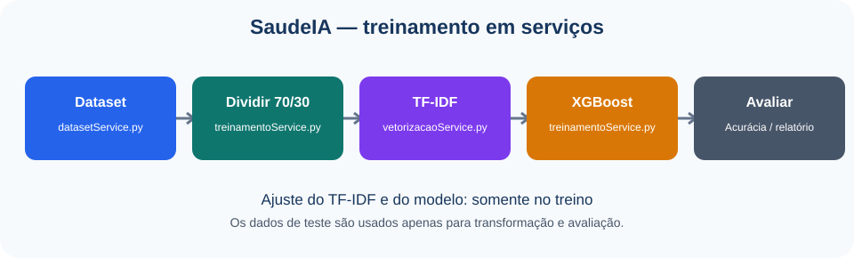
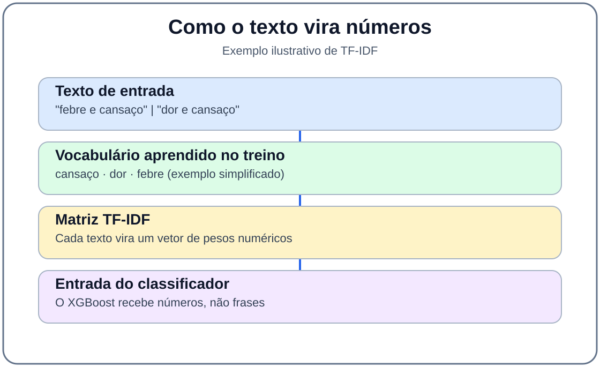
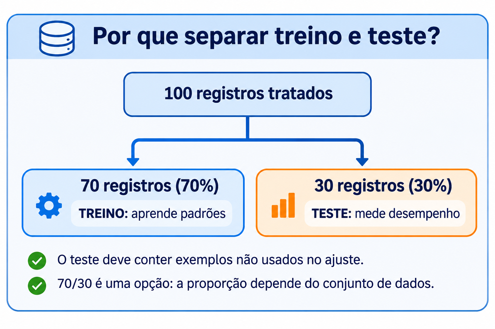
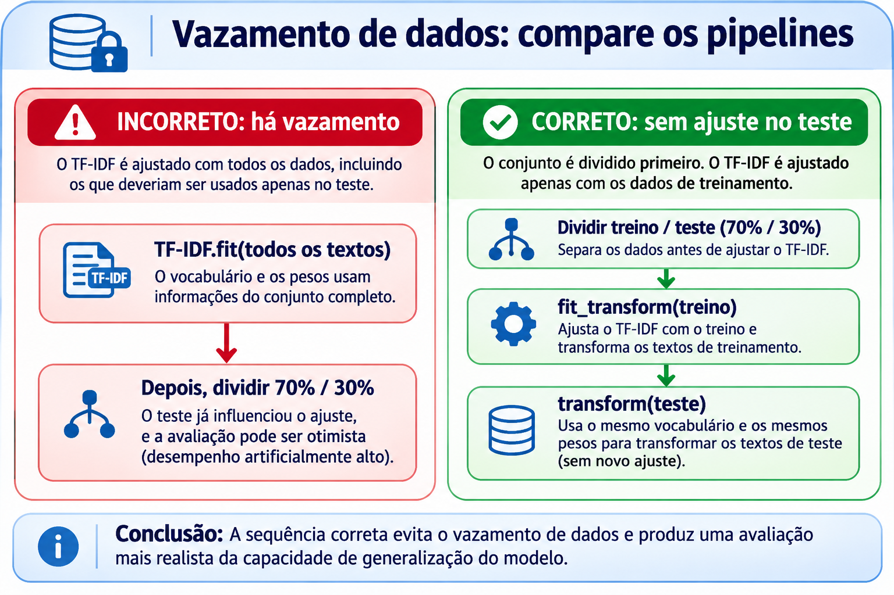
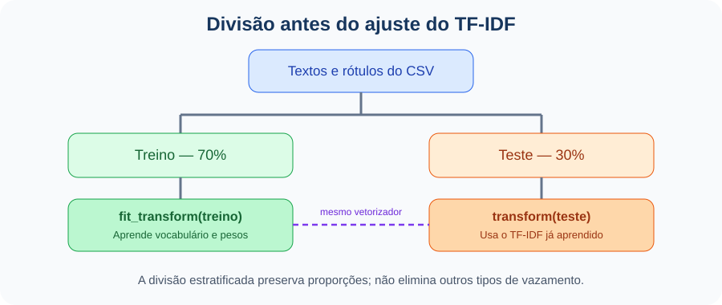
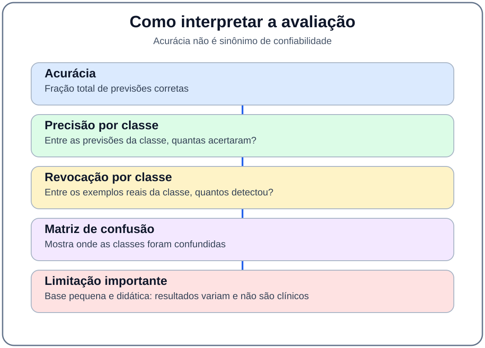

# Aula 02 — Vetorização TF-IDF e Treinamento com XGBoost

**Disciplina:** Programação para Engenharia Mecânica — 2026.2  
**Projeto Avaliativo 3:** SaudeIA — Inteligência Artificial Aplicada à Engenharia  
**Ambiente:** Windows · VSCode · PowerShell · Python 3.12 · Pandas · scikit-learn · XGBoost

> **Uso exclusivamente didático.** O conjunto de sintomas e rótulos não permite realizar diagnósticos médicos. O mesmo processo de classificação pode ser aplicado, por exemplo, a descrições de falhas de máquinas.

## 1. Objetivo da aula

Nesta aula, utilizaremos o CSV tratado na Aula 01 para **transformar textos em números**, **treinar um classificador XGBoost** e **avaliar as previsões** com dados separados do treinamento. **Não** criaremos ainda a interface web nem salvaremos o modelo definitivo: essas etapas serão abordadas nas próximas aulas. Trabalharemos com os módulos `services/datasetService.py`, `services/vetorizacaoService.py` e `services/treinamentoService.py`, utilizados pela aplicação SaudeIA.

<p align="center"></p>
<p align="center"><em>Figura 1 — Sequência do processamento de Machine Learning nesta aula.</em></p>

## 2. Teoria essencial: TF-IDF e XGBoost

O computador não interpreta diretamente uma frase como `"febre e cansaço"`. O **TF-IDF** transforma textos em vetores numéricos: palavras frequentes em um documento, mas menos comuns no conjunto, podem receber maior peso. O **XGBoost** usa esses valores para aprender padrões de classificação por meio de um conjunto de árvores de decisão.

| Elemento | Função no projeto |
|---|---|
| `TfidfVectorizer` | Aprende um vocabulário e converte textos em uma matriz numérica. |
| `LabelEncoder` | Converte nomes de classes em códigos inteiros. |
| `train_test_split` | Reserva registros para avaliar o modelo em dados não usados no ajuste. |
| `XGBClassifier` | Treina o classificador supervisionado. |
| `accuracy_score` | Mede a proporção de acertos no conjunto de teste. |
| `classification_report` | Mostra precisão, revocação e F1 por classe. |

<p align="center"></p>
<p align="center"><em>Figura 2 — O TF-IDF transforma textos em características numéricas que podem ser utilizadas pelo XGBoost.</em></p>

## 3. Por que separar treinamento e teste? (70% / 30%)

O **treinamento** permite que o algoritmo aprenda padrões a partir de exemplos com respostas conhecidas. O **teste** verifica como o modelo se comporta diante de exemplos que **não foram usados para ajustá-lo**. Sem essa separação, mediríamos principalmente a capacidade de reproduzir os próprios exemplos estudados.

A divisão **70% para treino e 30% para teste** é uma escolha didática, **não uma regra universal**. Em 100 registros, seriam aproximadamente 70 para aprender e 30 para avaliar. Com poucos registros, cada classe pode ficar com poucos exemplos no teste; nesse caso, a avaliação apresenta grande incerteza. Outras estratégias incluem 80/20 e validação cruzada, sempre respeitando a separação de dados relacionados.

<p align="center"></p>
<p align="center"><em>Figura 3 — O modelo aprende no treino e é avaliado com dados reservados. 70/30 é uma escolha, não uma garantia.</em></p>

## 4. Vazamento de dados: o que é e como evitar

**Vazamento de dados (*data leakage*)** ocorre quando informações que não deveriam estar disponíveis durante o treinamento acabam influenciando o ajuste do modelo ou a avaliação. O resultado pode parecer melhor do que o desempenho real em dados novos.

**Exemplo A — TF-IDF ajustado antes da divisão:** `fit_transform()` aprende o vocabulário e os pesos das palavras. Se for aplicado a todos os textos antes da divisão, o conjunto de teste participa indiretamente dessa aprendizagem. A ordem correta é **dividir primeiro**, ajustar o TF-IDF somente no treino e usar `transform()` no teste.

**Exemplo B — registros repetidos:** se a frase `dor de cabeça e febre` com o mesmo rótulo aparecer no treino e no teste, o acerto no teste pode representar memorização. Remover duplicatas exatas antes da divisão ajuda, mas textos quase iguais, registros do mesmo paciente ou do mesmo equipamento também podem exigir uma **divisão por grupos**.

**Exemplo C — informação da resposta na entrada:** um campo como `diagnostico_confirmado` incluído indevidamente nas características revelaria ao modelo a própria resposta que queremos prever.

<p align="center"></p>
<p align="center"><em>Figura 4 — Comparação entre pipeline incorreto e correto. Dados de teste não podem ajustar o vetorizador nem o classificador.</em></p>

**Importante:** `stratify=y` mantém aproximadamente a proporção das classes, **mas não evita vazamento**. A divisão 70/30, por si só, também não garante independência. Uma acurácia muito alta não prova vazamento: é motivo para investigar duplicatas, variáveis indevidas e o método de avaliação.

<p align="center"></p>
<p align="center"><em>Figura 5 — Depois da divisão, o treino usa fit_transform(); o teste usa apenas transform().</em></p>


## 5. Preparar o ambiente e identificar os arquivos

No **PowerShell integrado ao VSCode**, execute:

```powershell
cd C:\Projetos\SaudeIA
.\.venv\Scripts\Activate.ps1
python -c "import pandas, sklearn, xgboost; print('Bibliotecas de ML disponíveis')"
Test-Path .\dados\processados\dataset_limpo.csv
Test-Path .\dataset_limpo.csv
```

Pelo menos um dos dois caminhos do CSV deve existir. O primeiro é a saída tratada da Aula 01; o segundo é a localização da versão original do SaudeIA. O conjunto precisa conter as colunas `sintomas` e `diagnostico`.

**Por que utilizaremos três módulos?** `datasetService.py` lê os registros; `vetorizacaoService.py` transforma textos e classes em números; `treinamentoService.py` separa os dados, treina o XGBoost e calcula a acurácia. Essa divisão facilita a manutenção do programa.

## 6. Implementar os serviços do treinamento

### 6.1. Leitura do dataset — `services/datasetService.py`

**O que faz?** Carrega os textos e seus rótulos. Antes de treinar, remove valores vazios e registros exatamente repetidos para reduzir o risco de um mesmo exemplo aparecer no treino e no teste. Não altera o CSV no disco.

No terminal, crie o arquivo **somente se ainda não existir** e abra-o:

```powershell
New-Item -ItemType Directory -Force .\services | Out-Null
if (-not (Test-Path .\services\datasetService.py)) { New-Item -ItemType File .\services\datasetService.py | Out-Null }
code .\services\datasetService.py
```

**Copie todo o código abaixo para `services/datasetService.py` e salve com Ctrl+S.** Se já houver código, faça uma cópia de segurança antes de substituí-lo.

```python
"""Leitura e verificação dos dados para treinamento do SaudeIA."""
from pathlib import Path
import pandas as pd

# Pasta raiz do projeto: C:\Projetos\SaudeIA.
RAIZ = Path(__file__).resolve().parents[1]


def dataset_completo():
    """Devolve um DataFrame com sintomas e diagnóstico, sem duplicatas exatas."""
    # Prioriza o CSV tratado na Aula 01; aceita a localização original.
    candidatos = [
        RAIZ / "dados" / "processados" / "dataset_limpo.csv",
        RAIZ / "dataset_limpo.csv",
    ]
    caminho = next((p for p in candidatos if p.is_file()), None)
    if caminho is None:
        raise FileNotFoundError("dataset_limpo.csv não encontrado no projeto")

    df = pd.read_csv(caminho, encoding="utf-8")
    if not {"sintomas", "diagnostico"}.issubset(df.columns):
        raise ValueError("O CSV precisa ter as colunas sintomas e diagnostico")

    df = df[["sintomas", "diagnostico"]].dropna().copy()
    df["sintomas"] = df["sintomas"].astype(str).str.strip()
    df["diagnostico"] = df["diagnostico"].astype(str).str.strip()
    df = df[(df["sintomas"] != "") & (df["diagnostico"] != "")]
    df = df.drop_duplicates(subset=["sintomas", "diagnostico"])

    # Uma frase idêntica não deve corresponder a rótulos conflitantes.
    if df["sintomas"].duplicated().any():
        raise ValueError("Há sintomas idênticos com diagnósticos diferentes")
    if df["diagnostico"].nunique() < 2:
        raise ValueError("O treinamento requer pelo menos duas classes")
    return df.reset_index(drop=True)


def main():
    df = dataset_completo()
    print("Registros disponíveis:", len(df))
    print("Classes:", df["diagnostico"].nunique())
    print(df.head())


if __name__ == "__main__":
    main()
```

Teste a leitura:

```powershell
python -m services.datasetService
```

### 6.2. Vetorização e codificação — `services/vetorizacaoService.py`

**O que faz?** O TF-IDF aprende um vocabulário com `fit_transform()` e transforma textos novos com `transform()`. O LabelEncoder converte nomes de classes em números. **Nesta versão, não ajustaremos o TF-IDF antes de dividir treino e teste.**

```powershell
if (-not (Test-Path .\services\vetorizacaoService.py)) { New-Item -ItemType File .\services\vetorizacaoService.py | Out-Null }
code .\services\vetorizacaoService.py
```

**Copie o código abaixo para `services/vetorizacaoService.py` e salve.** Preserve uma cópia do conteúdo anterior, se existir.

```python
"""Transformação de textos e codificação das classes do SaudeIA."""
from sklearn.feature_extraction.text import TfidfVectorizer
from sklearn.preprocessing import LabelEncoder
from services.datasetService import dataset_completo


def criar_vetorizador(textos_treino, textos_teste=None):
    """Aprende TF-IDF somente no treino e transforma o teste sem reajuste."""
    tfidf = TfidfVectorizer()
    X_treino = tfidf.fit_transform(textos_treino)
    if textos_teste is None:
        return tfidf, X_treino
    X_teste = tfidf.transform(textos_teste)
    return tfidf, X_treino, X_teste


def criar_encoderY(rotulos=None):
    """Codifica os nomes das classes; aceita os rótulos fornecidos."""
    if rotulos is None:
        rotulos = dataset_completo()["diagnostico"]
    encoder = LabelEncoder()
    Y = encoder.fit_transform(rotulos)
    return encoder, Y


def main():
    # Demonstra o serviço sem usar os dados de teste para ajustar o TF-IDF.
    from sklearn.model_selection import train_test_split
    df = dataset_completo()
    treino, teste = train_test_split(
        df["sintomas"], test_size=0.30, random_state=42
    )
    tfidf, X_treino, X_teste = criar_vetorizador(treino, teste)
    encoder, Y = criar_encoderY(df["diagnostico"])
    print("Matriz de treino:", X_treino.shape)
    print("Matriz de teste:", X_teste.shape)
    print("Classes:", len(encoder.classes_))
    print("Rótulos codificados:", len(Y))


if __name__ == "__main__":
    main()
```

Execute:

```powershell
python -m services.vetorizacaoService
```

### 6.3. Treinamento XGBoost — `services/treinamentoService.py`

**O que faz?** Separa treino/teste, chama a vetorização na ordem correta, treina o XGBoost e avalia o resultado. A função `treinar_modelo()` devolve **cinco objetos**, nesta ordem: `modelo` (XGBoost), `tfidf` (vetorizador), `encoder` (codificador), `X_teste` (matriz de teste) e `Y_teste` (rótulos reais de teste). Essa sequência será utilizada para salvar os componentes na Aula 03.

```powershell
if (-not (Test-Path .\services\treinamentoService.py)) { New-Item -ItemType File .\services\treinamentoService.py | Out-Null }
code .\services\treinamentoService.py
```

**Copie o código abaixo para `services/treinamentoService.py` e salve.** Faça backup do arquivo anterior, caso exista.

```python
"""Treinamento e avaliação TF-IDF + XGBoost do SaudeIA."""
from sklearn.model_selection import train_test_split
from sklearn.metrics import accuracy_score, classification_report
from xgboost import XGBClassifier
from services.datasetService import dataset_completo
from services.vetorizacaoService import criar_vetorizador, criar_encoderY


def treinar_modelo():
    """Devolve modelo, tfidf, encoder, X_teste e Y_teste."""
    df = dataset_completo()
    textos = df["sintomas"]
    encoder, Y = criar_encoderY(df["diagnostico"])

    # Divisão ANTES de ajustar o TF-IDF: evita vazamento de vocabulário.
    contagens = df["diagnostico"].value_counts()
    if contagens.min() < 2:
        raise ValueError("Cada classe precisa ter pelo menos dois registros")
    X_treino_txt, X_teste_txt, Y_treino, Y_teste = train_test_split(
        textos, Y, test_size=0.30, random_state=42, stratify=Y
    )

    # fit_transform apenas no treino; transform apenas no teste.
    tfidf, X_treino, X_teste = criar_vetorizador(
        X_treino_txt, X_teste_txt
    )

    modelo = XGBClassifier(
        n_estimators=150,
        learning_rate=0.03,
        max_depth=3,
        random_state=42,
        eval_metric="mlogloss",
        n_jobs=2,
    )
    modelo.fit(X_treino, Y_treino)
    return modelo, tfidf, encoder, X_teste, Y_teste


def acuracia_modelo():
    """Calcula a porcentagem de acertos nos registros reservados."""
    modelo, _, _, X_teste, Y_teste = treinar_modelo()
    Y_previsto = modelo.predict(X_teste)
    return accuracy_score(Y_teste, Y_previsto) * 100


def main():
    modelo, tfidf, encoder, X_teste, Y_teste = treinar_modelo()
    Y_previsto = modelo.predict(X_teste)
    print("=== SAUDEIA — TREINAMENTO TF-IDF + XGBOOST ===")
    print("Registros de teste:", len(Y_teste))
    print("Classes:", len(encoder.classes_))
    print("Termos do vocabulário:", len(tfidf.get_feature_names_out()))
    print("Acurácia:", round(accuracy_score(Y_teste, Y_previsto) * 100, 2), "%")
    print(classification_report(
        Y_teste, Y_previsto,
        labels=list(range(len(encoder.classes_))),
        target_names=encoder.classes_, zero_division=0,
    ))


if __name__ == "__main__":
    main()
```

## 7. Executar o treinamento

No terminal, execute:

```powershell
python -m services.treinamentoService
```

O programa deverá mostrar a quantidade de registros de teste, o número de classes, o tamanho do vocabulário e as métricas. **Não existe acurácia mínima garantida**: o resultado depende do dataset, da divisão e dos parâmetros escolhidos. Os objetos treinados ainda estão em memória; **na Aula 03**, serão gravados em `model/` com os nomes esperados pelo SaudeIA original.

## 8. Interpretar os resultados

A **acurácia** é a proporção de previsões corretas. A **precisão** mede quantas previsões de uma classe estavam corretas; a **revocação** mede quantos exemplos reais daquela classe foram identificados; o **F1** combina precisão e revocação. A **matriz de confusão** mostra os tipos de erro.

<p align="center"></p>
<p align="center"><em>Figura 6 — As métricas revelam aspectos diferentes do desempenho do classificador.</em></p>

**Limitação didática:** textos muito semelhantes, mesmo sem serem duplicatas exatas, podem aparecer em treino e teste e inflar as métricas. Um desempenho elevado nesta base pequena **não demonstra validade clínica** nem garante generalização para dados reais.

## 9. Criar testes automatizados

**Por que testar?** Precisamos verificar que a leitura remove duplicatas e, principalmente, que o TF-IDF **não aprende palavras exclusivas do conjunto de teste**.

```powershell
New-Item -ItemType Directory -Force .\tests | Out-Null
if (-not (Test-Path .\tests\test_treinamentoService.py)) { New-Item -ItemType File .\tests\test_treinamentoService.py | Out-Null }
code .\tests\test_treinamentoService.py
```

**Copie o código abaixo para `tests/test_treinamentoService.py` e salve.**

```python
"""Testes rápidos dos serviços de dados e vetorização."""
import pandas as pd
from services.vetorizacaoService import criar_vetorizador, criar_encoderY


def test_tfidf_nao_aprende_palavra_do_teste():
    # 'exclusivadoteste' aparece somente no teste e não pode entrar no vocabulário.
    tfidf, X_treino, X_teste = criar_vetorizador(
        ["febre persistente", "dor muscular"],
        ["exclusivadoteste febre"],
    )
    assert "exclusivadoteste" not in tfidf.vocabulary_
    assert X_treino.shape[1] == X_teste.shape[1]


def test_encoder_devolve_classes_numericas():
    encoder, y = criar_encoderY(pd.Series(["classe_b", "classe_a", "classe_b"]))
    assert len(encoder.classes_) == 2
    assert len(y) == 3


def test_vetorizador_nao_usa_fit_no_teste():
    tfidf, _, _ = criar_vetorizador(["palavra treino"], ["outrapalavra teste"])
    assert "outrapalavra" not in tfidf.get_feature_names_out()
```

Execute:

```powershell
python -m pytest -q tests/test_treinamentoService.py
```

**Resultado esperado:** `3 passed`. Se `pytest` não estiver instalado: `python -m pip install pytest`.

## 10. Atividade prática

Altere **apenas um parâmetro por vez** em `XGBClassifier`: por exemplo, `n_estimators=50` e depois `n_estimators=150`. Execute novamente e registre a acurácia, observando que um aumento de árvores **não garante** melhor resultado. Explique por que não devemos escolher parâmetros apenas para maximizar o resultado de um único conjunto de teste.

**Questão para discussão:** se cinco medições vêm do mesmo equipamento, distribuí-las aleatoriamente entre treino e teste pode inflar a avaliação? Como uma divisão por equipamento ajudaria?

**Aplicação em Engenharia Mecânica:** imagine substituir `sintomas` por `descricao_falha` e `diagnostico` por `tipo_falha`. O fluxo de classificação é semelhante, desde que os dados sejam adequados e as classes estejam corretamente rotuladas.

## 11. Verificação final

- [ ] O CSV tratado da Aula 01 ou o CSV original compatível foi encontrado.
- [ ] Os serviços executaram sem alterar o dataset.
- [ ] O TF-IDF foi ajustado somente com dados de treino.
- [ ] O XGBoost gerou previsões e métricas.
- [ ] Os três testes automatizados passaram.
- [ ] Consigo explicar a diferença entre treino e teste.
- [ ] Consigo identificar vazamento pelo TF-IDF, por duplicatas ou por características que revelam o rótulo.
- [ ] Sei explicar por que 70/30 não garante uma avaliação confiável.

**Próxima aula:** persistência dos três componentes em `model/modelo_saudeIA.json`, `model/vetorizador_saudeIA.pkl` e `model/encoderY_saudeIA.pkl`; carregamento para novas previsões.

---

© 2026 **Wilson Luciano** · Programação para Engenharia Mecânica · DMEC · UFS · SaudeIA — Inteligência Artificial Aplicada à Engenharia · Material didático · Versão 1.1 (em revisão)
