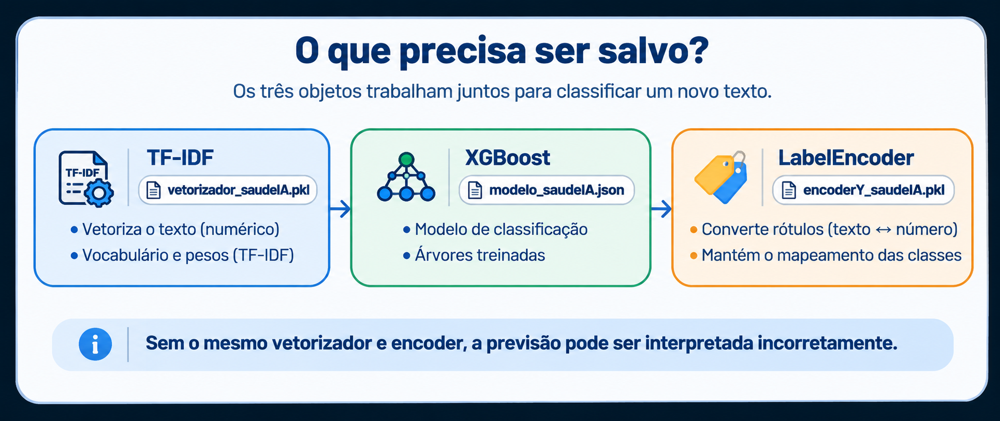
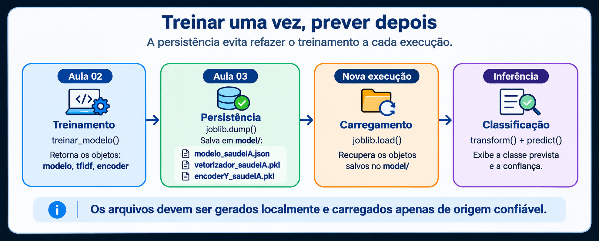
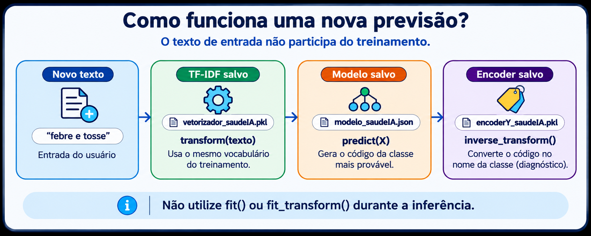

# Aula 03 — Persistência do Modelo e Previsões com o SaudeIA

**Disciplina:** Programação para Engenharia Mecânica — 2026.2  
**Projeto Avaliativo 3:** SaudeIA — Inteligência Artificial Aplicada à Engenharia  
**Ambiente:** Windows · VSCode · PowerShell · Python 3.12 · XGBoost · scikit-learn · joblib

> **Uso exclusivamente didático.** A classe prevista e a confiança estatística não constituem diagnóstico médico, probabilidade clínica validada nem recomendação de tratamento.

## 1. Objetivos

Na Aula 02, treinamos e avaliamos um classificador TF-IDF + XGBoost. Nesta aula, vamos **salvar os três componentes**, recuperá-los em outra execução e realizar previsões sem repetir o treinamento. Utilizaremos os módulos e os nomes de arquivos adotados pelo SaudeIA.

Ao final, você deverá conseguir: explicar persistência e inferência; gerar os três arquivos na pasta `model/`; carregar os objetos; classificar um texto; executar testes; e reconhecer os limites da confiança exibida.

## 2. Persistência: o que é e por que precisamos dela?

**Persistência** significa armazenar os resultados de um processamento para recuperá-los posteriormente. No Machine Learning, permite reutilizar um modelo já treinado mesmo depois de fechar o Python.

A função `treinar_modelo()` da Aula 02 devolve **cinco objetos, nesta ordem**:

```python
modelo, tfidf, encoder, X_teste, Y_teste = treinar_modelo()
```

| Objeto | Função | Precisamos salvar? |
|---|---|---|
| `modelo` | Classificador XGBoost treinado | Sim |
| `tfidf` | Vetorizador com vocabulário e pesos aprendidos no treino | Sim |
| `encoder` | Conversão entre nomes de classes e códigos numéricos | Sim |
| `X_teste` | Textos de teste já vetorizados, para avaliação | Não, nesta etapa |
| `Y_teste` | Respostas verdadeiras dos registros de teste | Não, nesta etapa |

Salvaremos os três primeiros componentes, mantendo os nomes que a aplicação web utilizará:

```text
model/
├── modelo_saudeIA.json
├── vetorizador_saudeIA.pkl
└── encoderY_saudeIA.pkl
```

O XGBoost será salvo com `modelo.save_model()` no formato JSON. Os objetos TF-IDF e LabelEncoder serão salvos com `joblib.dump()`, em arquivos `.pkl`. **Não renomeie os arquivos:** os módulos de previsão e a aplicação web dependem desses nomes.

<p align="center"></p>
<p align="center"><em>Figura 1 — Componentes persistidos e seus nomes de arquivos: TF-IDF (`.pkl`), XGBoost (`.json`) e LabelEncoder (`.pkl`).</em></p>

### 2.1. Salvar e carregar: exemplo rápido

```python
import joblib

# Salva um objeto Python já treinado.
joblib.dump(tfidf, "model/vetorizador_saudeIA.pkl")

# Recupera o objeto em outra execução.
tfidf_recuperado = joblib.load("model/vetorizador_saudeIA.pkl")
```

**Segurança:** `joblib.load()` pode executar código ao desserializar arquivos maliciosos. Carregue somente arquivos produzidos pelo próprio projeto ou por fontes confiáveis.

## 3. Preparar o ambiente

No PowerShell integrado ao VSCode:

```powershell
cd C:\Projetos\SaudeIA
.\.venv\Scripts\Activate.ps1

# Confere os serviços criados na Aula 02.
Test-Path .\services\treinamentoService.py
Test-Path .\services\vetorizacaoService.py

# Verifica se as bibliotecas estão disponíveis.
python -c "import xgboost, sklearn, joblib; print('Bibliotecas disponíveis')"
```

Os dois comandos `Test-Path` devem retornar `True`. Se faltar uma biblioteca, instale-a no ambiente virtual, por exemplo `python -m pip install joblib`.

## 4. Criar o módulo que salva os modelos

O arquivo `services/salvarmodelService.py` executará o treinamento da Aula 02 e gravará os três componentes na pasta `model/`.

```powershell
# Garante que as pastas existam.
New-Item -ItemType Directory -Force .\services, .\model | Out-Null

# Cria o arquivo apenas se ainda não existir.
if (-not (Test-Path .\services\salvarmodelService.py)) {
    New-Item -ItemType File .\services\salvarmodelService.py | Out-Null
}

# Abre o arquivo para edição.
code .\services\salvarmodelService.py
```

**Arquivo de destino: `services/salvarmodelService.py`.** Se ele já tiver conteúdo, faça uma cópia de segurança antes de substituí-lo. Copie todo o código abaixo e salve com **Ctrl+S**.

```python
"""Treina e salva os componentes do SaudeIA."""

from pathlib import Path
import joblib
from services.treinamentoService import treinar_modelo

# Pasta model/ localizada na raiz do projeto.
RAIZ = Path(__file__).resolve().parents[1]
PASTA_MODELO = RAIZ / "model"


def salvar_tudo():
    """Treina e grava XGBoost, TF-IDF e LabelEncoder."""
    # Mantém a ordem de retorno da Aula 02.
    modelo, tfidf, encoder, _, _ = treinar_modelo()

    # Cria a pasta de saída se ainda não existir.
    PASTA_MODELO.mkdir(parents=True, exist_ok=True)

    # O XGBoost possui um método próprio para salvar seu modelo.
    modelo.save_model(str(PASTA_MODELO / "modelo_saudeIA.json"))

    # Salva os objetos do scikit-learn para reutilização.
    joblib.dump(tfidf, PASTA_MODELO / "vetorizador_saudeIA.pkl")
    joblib.dump(encoder, PASTA_MODELO / "encoderY_saudeIA.pkl")

    print("Treinamento concluído. Arquivos salvos em model/:")
    print("- modelo_saudeIA.json")
    print("- vetorizador_saudeIA.pkl")
    print("- encoderY_saudeIA.pkl")


def main():
    """Permite executar este serviço diretamente."""
    salvar_tudo()


if __name__ == "__main__":
    main()
```

**O que acontece?** `treinar_modelo()` realiza o treinamento e a avaliação conforme a Aula 02; `save_model()` grava o XGBoost; `joblib.dump()` grava os dois objetos auxiliares. Os dados de teste não são usados para reajustar o TF-IDF.

<p align="center"></p>
<p align="center"><em>Figura 2 — Treinamento, persistência, carregamento e inferência com os componentes do SaudeIA.</em></p>

**Observação técnica sobre a Figura 2:** o comando `joblib.dump()` salva somente o TF-IDF e o LabelEncoder (`.pkl`). O XGBoost (`.json`) é salvo com `modelo.save_model()`. Da mesma forma, no carregamento, usamos `joblib.load()` para os arquivos `.pkl` e `modelo.load_model()` para o arquivo `.json`.

### 4.1. Gerar os três arquivos

Execute **a partir da raiz do projeto**, com o ambiente virtual ativado:

```powershell
python -m services.salvarmodelService

# Lista os arquivos gerados.
Get-ChildItem .\model
```

O resultado deve incluir os três nomes apresentados acima. Se ocorrer erro de leitura do CSV, volte à Aula 02 e confira o caminho do conjunto tratado. O treinamento pode demorar conforme o computador e os dados.

## 5. Previsões: o que é inferência?

**Inferência** é utilizar os componentes já treinados para classificar um novo texto, sem executar novamente `fit()` ou `fit_transform()`.

O SaudeIA realiza quatro operações:

1. Recebe a descrição de sintomas digitada pelo usuário.
2. O TF-IDF salvo executa **`transform()`** para converter o texto em números.
3. O XGBoost salvo executa **`predict()`** e, quando disponível, **`predict_proba()`**.
4. O LabelEncoder executa **`inverse_transform()`** para recuperar o nome da classe.

<p align="center"></p>
<p align="center"><em>Figura 3 — O texto é vetorizado com `tfidf.transform([texto])`, classificado com `modelo.predict(X)` e decodificado com `encoder.inverse_transform(...)`. A saída é uma classificação didática, não um diagnóstico médico.</em></p>

| Treinamento | Inferência |
|---|---|
| `tfidf.fit_transform(textos_treino)` | `tfidf.transform([texto_novo])` |
| `modelo.fit(X_treino, Y_treino)` | `modelo.predict(X_novo)` |
| `encoder.fit_transform(classes)` | `encoder.inverse_transform(codigos)` |

**Atenção:** a confiança retornada por `predict_proba()` é uma estimativa do classificador e **não** representa certeza de diagnóstico ou probabilidade clínica validada.

## 6. Criar o módulo de diagnóstico

O módulo `services/diagnosticoIA.py` será responsável por carregar os arquivos e classificar textos. Ele também será utilizado pela aplicação FastAPI nas próximas aulas.

```powershell
if (-not (Test-Path .\services\diagnosticoIA.py)) {
    New-Item -ItemType File .\services\diagnosticoIA.py | Out-Null
}
code .\services\diagnosticoIA.py
```

**Arquivo de destino: `services/diagnosticoIA.py`.** Se já existir, faça uma cópia antes de editar. Copie o código completo abaixo e salve com **Ctrl+S**.

```python
"""Carregamento dos modelos e inferência didática do SaudeIA."""

from pathlib import Path
import joblib
import xgboost as xgb


class DiagnosticoIA:
    """Reutiliza os três componentes produzidos no treinamento."""

    # Apresentação amigável das classes do conjunto de demonstração.
    MAPA_DOENCAS = {
        "anemia_falciforme": "Anemia Falciforme",
        "artrite_reumatoide": "Artrite Reumatoide",
        "diabetes_tipo1": "Diabetes Tipo 1",
        "doenca_alzheimer": "Doença de Alzheimer",
        "doenca_crohn": "Doença de Crohn",
        "doenca_lyme": "Doença de Lyme",
        "doenca_parkinson": "Doença de Parkinson",
        "doenca_wilson": "Doença de Wilson",
        "esclerose_lateral": "Esclerose Lateral",
        "esclerose_multipla": "Esclerose Múltipla",
        "febre_maculosa": "Febre Maculosa",
        "fibromialgia": "Fibromialgia",
        "hipertireoidismo": "Hipertireoidismo",
        "lupus": "Lúpus",
        "miastenia_gravis": "Miastenia Gravis",
        "porfiria": "Porfiria",
        "sarcoidose": "Sarcoidose",
        "sindrome_fadiga_cronica": "Síndrome da Fadiga Crônica",
        "sindrome_sjogren": "Síndrome de Sjögren",
    }

    def __init__(self, pasta_model="model"):
        """Carrega modelo, vetorizador e encoder da pasta indicada."""
        pasta = Path(pasta_model)
        if not pasta.is_absolute():
            # Resolve caminhos relativos a partir da raiz do projeto.
            pasta = Path(__file__).resolve().parents[1] / pasta

        arquivos = [
            pasta / "modelo_saudeIA.json",
            pasta / "vetorizador_saudeIA.pkl",
            pasta / "encoderY_saudeIA.pkl",
        ]
        faltantes = [p.name for p in arquivos if not p.is_file()]
        if faltantes:
            raise FileNotFoundError(
                "Arquivos do modelo ausentes: " + ", ".join(faltantes)
                + ". Execute: python -m services.salvarmodelService"
            )

        # XGBoost: carrega o arquivo JSON criado por save_model().
        self.modelo = xgb.XGBClassifier()
        self.modelo.load_model(str(arquivos[0]))

        # scikit-learn: carrega objetos previamente serializados.
        # Nunca carregue arquivos .pkl de origem desconhecida.
        self.vectorizer = joblib.load(arquivos[1])
        self.encoder = joblib.load(arquivos[2])

    def prever(self, texto):
        """Retorna (classe_legivel, confianca) para um texto novo."""
        if not isinstance(texto, str) or not texto.strip():
            raise ValueError("Informe um texto não vazio.")

        # Não reaprende o vocabulário: usa SOMENTE transform().
        X = self.vectorizer.transform([texto.strip()])
        classe = self.modelo.predict(X)[0]
        codigo = self.encoder.inverse_transform([int(classe)])[0]

        # Apresenta o nome de forma amigável, sem mudar a classe.
        nome = str(codigo)
        nome_legivel = self.MAPA_DOENCAS.get(
            nome, nome.replace("_", " ").title()
        )

        # Confiança do classificador, não probabilidade clínica.
        probabilidades = self.modelo.predict_proba(X)[0]
        confianca = float(max(probabilidades))
        return nome_legivel, confianca


def main():
    """Teste simples de previsão pelo terminal."""
    ia = DiagnosticoIA("model")
    texto = "febre, dor de cabeça e cansaço"
    classe, confianca = ia.prever(texto)
    print("Sintomas:", texto)
    print("Classe prevista:", classe)
    print("Confiança do classificador:", f"{confianca:.2%}")
    print("AVISO: demonstração didática; não é diagnóstico médico.")


if __name__ == "__main__":
    main()
```

**Por que usamos `load_model()` e `joblib.load()`?** O XGBoost lê seu formato próprio JSON; os objetos do scikit-learn são recuperados dos arquivos `.pkl`. O modelo **não** é treinado novamente durante a previsão.

## 7. Testar a inferência

No terminal:

```powershell
# Primeiro, gere os arquivos se ainda não existirem.
Get-ChildItem .\model

# Depois, execute a previsão.
python -m services.diagnosticoIA
```

A saída mostrará o texto utilizado, a classe prevista e a confiança do classificador. **Não existe classe ou percentual garantido**: dependem dos dados e do treinamento.

## 8. Criar testes automatizados

Vamos verificar a persistência, o carregamento e a inferência sem depender de uma classe médica específica. Para evitar modificar os arquivos do aluno, o teste usa uma pasta temporária.

```powershell
New-Item -ItemType Directory -Force .\tests | Out-Null
if (-not (Test-Path .\tests\test_modelos_saudeia.py)) {
    New-Item -ItemType File .\tests\test_modelos_saudeia.py | Out-Null
}
code .\tests\test_modelos_saudeia.py
```

**Copie todo o código abaixo para `tests/test_modelos_saudeia.py` e salve com Ctrl+S.**

```python
"""Testes rápidos dos arquivos e da inferência do SaudeIA."""

import joblib
import pytest
from sklearn.feature_extraction.text import TfidfVectorizer
from sklearn.preprocessing import LabelEncoder
from xgboost import XGBClassifier

from services.diagnosticoIA import DiagnosticoIA


def preparar_modelos_teste(pasta):
    """Cria componentes mínimos em uma pasta temporária."""
    textos = [
        "febre tosse", "tosse cansaço", "febre dor",
        "ruido bomba", "vibracao motor", "falha rolamento",
    ]
    rotulos = ["saude", "saude", "saude", "maquina", "maquina", "maquina"]

    tfidf = TfidfVectorizer()
    X = tfidf.fit_transform(textos)
    encoder = LabelEncoder()
    y = encoder.fit_transform(rotulos)

    modelo = XGBClassifier(n_estimators=4, max_depth=2, random_state=42, n_jobs=1)
    modelo.fit(X, y)
    modelo.save_model(str(pasta / "modelo_saudeIA.json"))
    joblib.dump(tfidf, pasta / "vetorizador_saudeIA.pkl")
    joblib.dump(encoder, pasta / "encoderY_saudeIA.pkl")


def test_arquivos_gerados(tmp_path):
    preparar_modelos_teste(tmp_path)
    assert (tmp_path / "modelo_saudeIA.json").is_file()
    assert (tmp_path / "vetorizador_saudeIA.pkl").is_file()
    assert (tmp_path / "encoderY_saudeIA.pkl").is_file()


def test_carregamento_e_previsao(tmp_path):
    preparar_modelos_teste(tmp_path)
    ia = DiagnosticoIA(tmp_path)
    classe, confianca = ia.prever("vibracao motor")
    assert isinstance(classe, str) and classe
    assert 0 <= confianca <= 1


def test_texto_vazio(tmp_path):
    preparar_modelos_teste(tmp_path)
    ia = DiagnosticoIA(tmp_path)
    with pytest.raises(ValueError, match="não vazio"):
        ia.prever("   ")


def test_arquivos_ausentes(tmp_path):
    with pytest.raises(FileNotFoundError, match="Arquivos do modelo ausentes"):
        DiagnosticoIA(tmp_path)
```

Execute:

```powershell
python -m pytest -q tests/test_modelos_saudeia.py
```

**Resultado esperado:** quatro testes aprovados. Os testes usam dados artificiais e verificam a infraestrutura; **não medem a qualidade clínica do modelo**.

## 9. Exercícios de fixação

1. Gere os três arquivos em `model/`, encerre o terminal e execute apenas `python -m services.diagnosticoIA`. Explique por que o treinamento não foi repetido.
2. Troque o texto de exemplo em `main()` por três frases diferentes e compare as classes previstas.
3. Explique por que utilizar `fit_transform()` em um texto novo seria incorreto.
4. **Engenharia Mecânica:** imagine um classificador de descrições de falhas em bombas. Quais três componentes precisariam ser salvos para reutilizar esse sistema?

## 10. Verificação final

- [ ] Utilizei os módulos `salvarmodelService.py` e `diagnosticoIA.py`.
- [ ] Gerei os três arquivos com os nomes esperados em `model/`.
- [ ] Consegui realizar uma previsão sem repetir o treinamento.
- [ ] Entendo a diferença entre `fit_transform()` e `transform()`.
- [ ] Executei os quatro testes automatizados.
- [ ] Sei que a confiança do modelo não representa validade clínica.

**Próxima aula:** FastAPI e interface web utilizando `main_api.py`, os serviços e os modelos salvos nesta aula.

---

© 2026 **Wilson Luciano** · Programação para Engenharia Mecânica · DMEC · UFS · SaudeIA — Inteligência Artificial Aplicada à Engenharia · Material didático · Versão 1.0
