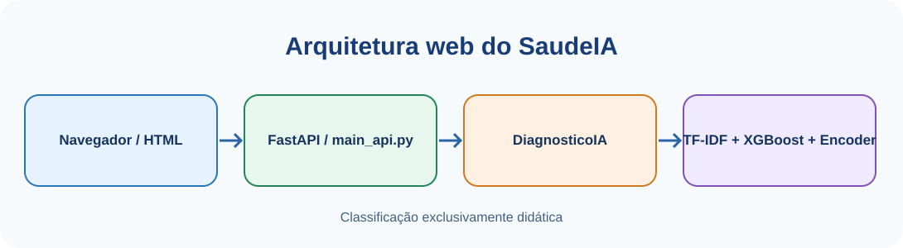

# Aula 04 — Aplicação Web do SaudeIA com FastAPI, API e QR Code

**Disciplina:** Programação para Engenharia Mecânica — 2026.2  
**Projeto Avaliativo 3:** SaudeIA — Inteligência Artificial Aplicada à Engenharia  
**Ambiente:** Windows · VSCode · PowerShell · Python 3.12 · `.venv` · FastAPI · HTML · CSS

> **Finalidade exclusivamente didática:** este sistema classifica textos; não realiza diagnóstico médico, não recomenda tratamento e não substitui profissionais de saúde. Utilize somente sintomas fictícios nas atividades.

## 1. Objetivos da aula

Ao concluir, você será capaz de: (1) explicar frontend, backend, API e agente conversacional; (2) construir o servidor FastAPI com o `main_api.py`; (3) conectar a interface HTML ao classificador local treinado nas Aulas 02 e 03; (4) configurar com segurança uma chave de API externa; (5) executar a aplicação no computador e no celular via QR Code; (6) validar as rotas e publicar o código sem segredos no GitHub.

**Pré-requisito:** os arquivos da Aula 03 devem existir em `model/`: `modelo_saudeIA.json`, `vetorizador_saudeIA.pkl` e `encoderY_saudeIA.pkl`. Não treinaremos novamente o modelo nesta aula.

## 2. Arquitetura da aplicação

- **Frontend:** `templates/index.html` e `static/style.css` apresentam formulários e respostas.
- **Backend:** `main_api.py` recebe requisições HTTP com FastAPI e devolve páginas HTML ou JSON.
- **Classificador local:** `services/diagnosticoIA.py` carrega XGBoost, TF-IDF e LabelEncoder. **Não consome API da OpenAI.**
- **Assistente simples:** `/chat` envia uma pergunta ao modelo de linguagem, sem memória persistente da conversa.
- **Agente conversacional:** `/chat_agente` usa `services/agenteIA.py` e recebe mensagens anteriores da sessão. Nesta implementação, é um agente conversacional simples, **sem ferramentas autônomas**.
- **API JSON:** `/api/saude` verifica o servidor e `/api/prever` classifica textos enviados por outros programas.

<p align="center"></p>
<p align="center"><em>Figura 1 — Comunicação entre interface, servidor e componentes de classificação.</em></p>

**GET** solicita um recurso, como a página inicial. **POST** envia dados para processamento, como o formulário de sintomas. **JSON** é um formato de dados usado por APIs. A FastAPI disponibiliza documentação interativa em `/docs`.

## 3. Preparação e dependências

No PowerShell integrado ao VSCode, execute:

```powershell
cd C:\Projetos\SaudeIA
.\.venv\Scripts\Activate.ps1

# Confirma os três arquivos produzidos na Aula 03.
Test-Path .\model\modelo_saudeIA.json
Test-Path .\model\vetorizador_saudeIA.pkl
Test-Path .\model\encoderY_saudeIA.pkl

# Confirma a interface existente.
Test-Path .\templates\index.html
Test-Path .\static\style.css
```

Os cinco testes devem retornar `True`. Se os arquivos de modelo estiverem ausentes, conclua a persistência da Aula 03 antes de prosseguir.

Instale as bibliotecas necessárias no `.venv`:

```powershell
python -m pip install fastapi "uvicorn[standard]" jinja2 python-multipart qrcode[pil] openai httpx pytest
python -m pip show openai
```

O `python-multipart` permite ler os formulários HTML. `qrcode[pil]` gera o QR Code. `openai` conecta os recursos conversacionais à API externa. `httpx` e `pytest` permitem testar as rotas. Os pacotes de Machine Learning já foram instalados nas aulas anteriores.

## 4. Criar o módulo do agente conversacional

**Agente conversacional** é o componente que envia ao modelo de linguagem uma sequência de mensagens (`system`, `user`, `assistant`). O `main_api.py` administra o histórico temporário e o `agenteIA.py` realiza a chamada externa. Assim, a classificação XGBoost e a conversa com LLM permanecem separadas.

Crie o arquivo, caso ainda não exista:

```powershell
New-Item -ItemType Directory -Force .\services | Out-Null
if (-not (Test-Path .\services\agenteIA.py)) {
    New-Item -ItemType File .\services\agenteIA.py | Out-Null
}
code .\services\agenteIA.py
```

**Arquivo:** `services/agenteIA.py`. Antes de copiar, observe que `__init__()` prepara o cliente de comunicação, enquanto `perguntar_chat()` recebe uma lista de mensagens e devolve a resposta. Copie e salve:

```python
"""Cliente de linguagem para o agente conversacional educacional."""
# Cliente oficial: realiza requisições HTTPS à API externa.
from openai import OpenAI


class AgenteSaudeIA:
    """Encaminha mensagens ao modelo de linguagem pela API externa."""

    # O construtor é chamado quando o backend precisa de uma conversa.
    def __init__(self):
        # OPENAI_API_KEY é lida automaticamente do ambiente.
        self.client = OpenAI()

    # Método responsável por enviar a conversa e receber a resposta.
    def perguntar_chat(self, mensagens):
        """Recebe lista de mensagens (system/user/assistant) e devolve texto."""
        # model escolhe o LLM; messages preserva a ordem da conversa.
        # Esta chamada pode gerar custos na conta de API configurada.
        completion = self.client.chat.completions.create(
            model="gpt-4o-mini", messages=mensagens
        )
        # choices[0] seleciona a primeira resposta; content contém o texto.
        return completion.choices[0].message.content or "Sem resposta textual."
```

**Entendendo o código:** os comentários no arquivo explicam a criação do cliente, o envio das mensagens e a leitura da resposta. `from openai import OpenAI` importa o cliente oficial. `class AgenteSaudeIA` organiza a funcionalidade em uma classe; `self.client` guarda o cliente para reutilização. O parâmetro `mensagens` representa a conversa com os papéis `system` (instruções), `user` (pergunta) e `assistant` (resposta anterior). O método `create()` envia a requisição; `choices[0].message.content` extrai o texto. Uma chamada real pode consumir créditos da API.

Teste **sem consumir créditos**, apenas importando a classe:

```powershell
python -c "from services.agenteIA import AgenteSaudeIA; print('Importação OK')"
```

## 5. Chave de API da OpenAI: conceito, instalação e segurança

A **biblioteca Python** (`openai`) não é a **chave de API** (`OPENAI_API_KEY`). A biblioteca permite a comunicação; a chave identifica o projeto autorizado; as chamadas podem gerar custos de uso. Uma assinatura do ChatGPT não equivale a créditos de API. Consulte o painel de consumo e faturamento da conta correspondente.

**Obter a chave:** entre em https://platform.openai.com/api-keys, escolha o projeto e crie uma chave secreta, conforme as opções disponíveis na conta. Não compartilhe a chave. Consulte o uso em https://platform.openai.com/usage.

### 5.1. Verificar a instalação sem revelar o segredo

```powershell
python -m pip show openai

if ($env:OPENAI_API_KEY) {
    Write-Host "Chave configurada nesta sessão."
} else {
    Write-Host "Chave não encontrada nesta sessão."
}

[bool][Environment]::GetEnvironmentVariable("OPENAI_API_KEY", "User")
```

**Não utilize `echo $env:OPENAI_API_KEY`: esse comando mostra a chave completa na tela.**

### 5.2. Três formas de fornecer a chave

**A — Diretamente no código (não recomendado):** `OpenAI(api_key="SUA_CHAVE")`. É tecnicamente possível, mas expõe o segredo ao compartilhar o arquivo ou publicar no GitHub. **Não adote este método nas atividades.**

**B — Variável de ambiente temporária no PowerShell:**

```powershell
$env:OPENAI_API_KEY = "COLE_SUA_CHAVE_AQUI"
```

Vale apenas para o terminal atual e os processos iniciados a partir dele.

**C — Variável de ambiente persistente do usuário Windows:**

```powershell
[Environment]::SetEnvironmentVariable(
    "OPENAI_API_KEY", "COLE_SUA_CHAVE_AQUI", "User"
)
```

Feche e abra um **novo terminal** antes de testar. Também é possível utilizar `setx OPENAI_API_KEY "COLE_SUA_CHAVE_AQUI"`, que só atualiza os próximos terminais.

**Alternativa para projetos em equipe — arquivo `.env`:** instale `python-dotenv`, crie um `.env` local com `OPENAI_API_KEY=...`, adicione `.env` ao `.gitignore` e carregue com `from dotenv import load_dotenv; load_dotenv()` **antes de instanciar** `OpenAI()`. Disponibilize apenas um `.env.example` sem chave. Neste roteiro, utilizaremos a variável de ambiente do Windows, dispensando dependência adicional.

**Erro `401`:** verifique chave/projeto. **Erro `429` com `insufficient_quota`:** verifique limites, créditos e faturamento. **Erro de conexão:** verifique internet/proxy. Evite colocar dados reais de pacientes nas requisições externas.

## 6. Construir o backend completo

O único arquivo principal do projeto é `main_api.py`. Ele carrega os três componentes persistidos na Aula 03, atende os formulários originais, registra histórico CSV e expõe as rotas JSON. Todas as chamadas de `TemplateResponse()` usam a sintaxe atual: `request=request, name="index.html", context={...}`.

Antes de substituir o arquivo, crie uma cópia de segurança:

```powershell
Copy-Item .\main_api.py .\main_api_backup.py
code .\main_api.py
```

**Como ler o código:** acompanhe os comentários internos, que explicam o propósito de cada biblioteca, a configuração das pastas, o fluxo das rotas e a conversão da probabilidade em percentual. Não é necessário decorar cada instrução: relacione os comentários às etapas do processamento. Os `imports` disponibilizam bibliotecas; `app = FastAPI()` cria o servidor; `app.mount()` publica arquivos estáticos; `Jinja2Templates()` conecta o HTML; e os decoradores `@app.get()` / `@app.post()` definem as rotas. `Form()` recebe campos do formulário, `BaseModel` valida JSON e `TemplateResponse()` envia dados do Python ao HTML.

**Arquivo:** `main_api.py`. Copie o código completo abaixo e salve com `Ctrl+S`:

```python
"""SaudeIA: servidor FastAPI, inferência local e conversas com IA.

Este arquivo coordena a interface HTML, o classificador da Aula 03,
o histórico CSV, o QR Code e as rotas de comunicação externa.
"""
# Biblioteca padrão: escreve as classificações em uma tabela CSV.
import csv
# Registra a data e a hora de cada classificação.
from datetime import datetime
# Manipula caminhos de arquivos independentemente da pasta atual do terminal.
from pathlib import Path
# Descobre o endereço IPv4 da máquina para gerar o QR Code.
import socket
# Cria identificadores únicos para sessões de conversa.
import uuid

# Gera a imagem QR Code que aponta para o servidor na rede local.
import qrcode
# FastAPI define rotas; Form recebe formulários; Request representa a requisição.
# HTTPException devolve erros HTTP controlados, como 422.
from fastapi import FastAPI, Form, HTTPException, Request
# HTMLResponse identifica rotas que devolvem páginas HTML.
from fastapi.responses import HTMLResponse
# StaticFiles publica CSS, favicon e QR Code em /static.
from fastapi.staticfiles import StaticFiles
# Jinja2Templates renderiza index.html com valores enviados pelo Python.
from fastapi.templating import Jinja2Templates
# Cliente da API externa usado SOMENTE nas rotas de conversa.
from openai import OpenAI
# Pydantic descreve e valida os dados JSON de entrada e saída.
from pydantic import BaseModel, Field

# Reutiliza o classificador treinado e salvo na Aula 03 (sem API externa).
from services.diagnosticoIA import DiagnosticoIA
# Importa o serviço separado que conversa com o modelo de linguagem.
from services.agenteIA import AgenteSaudeIA

# __file__ aponta para este arquivo; .parent identifica a raiz do projeto.
BASE_DIR = Path(__file__).resolve().parent
# Caminhos absolutos evitam erros ao executar a aplicação em outro diretório.
STATIC_DIR = BASE_DIR / "static"
# Cria a pasta static se necessário, sem erro caso já exista.
STATIC_DIR.mkdir(exist_ok=True)
TEMPLATES_DIR = BASE_DIR / "templates"
HISTORICO = BASE_DIR / "historico.csv"

# A aplicação é criada uma única vez, antes dos decoradores de rotas.
app = FastAPI(title="SaudeIA", version="1.0")
# Faz /static/style.css e /static/qrcode.png ficarem acessíveis ao navegador.
app.mount("/static", StaticFiles(directory=str(STATIC_DIR)), name="static")
# Define onde estão as páginas HTML interpretadas pelo Jinja2.
templates = Jinja2Templates(directory=str(TEMPLATES_DIR))

# A classificação local usa os três arquivos persistidos na Aula 03.
# Instancia o classificador com os três artefatos já salvos; NÃO treina novamente.
ia = DiagnosticoIA(str(BASE_DIR / "model"))
chat_sessions = {}  # Memória temporária: perde-se ao reiniciar o servidor.


def descobrir_ip_local():
    """Descobre o IP IPv4 da rede; fallback para localhost se não houver rede."""
    try:
        # Um socket UDP permite identificar a interface de rede escolhida pelo SO.
        # connect() aqui não envia sintomas nem faz uma chamada à API da OpenAI.
        with socket.socket(socket.AF_INET, socket.SOCK_DGRAM) as conexao:
            conexao.connect(("8.8.8.8", 80))
            # Obtém o endereço local da interface de rede selecionada.
            return conexao.getsockname()[0]
    except OSError:
        # Fallback: acessível no computador, mas não necessariamente no celular.
        return "127.0.0.1"


def criar_qrcode():
    # O QR Code deve usar o IPv4 real, nunca 0.0.0.0.
    endereco = f"http://{descobrir_ip_local()}:8000"
    # O navegador poderá ler a imagem pela rota /static/qrcode.png.
    qrcode.make(endereco).save(STATIC_DIR / "qrcode.png")
    print("QR Code criado para:", endereco)


criar_qrcode()


def get_session_id(request: Request):
    # Reaproveita o cookie existente; sem ele, gera uma nova sessão.
    return request.cookies.get("session_id") or str(uuid.uuid4())


# GET /: exibe a página inicial sem enviar dados para classificação.
@app.get("/", response_class=HTMLResponse)
async def home(request: Request):
    # Sintaxe atual do Starlette: request e name são argumentos nomeados.
    return templates.TemplateResponse(request=request, name="index.html")


# POST /diagnosticar: recebe o campo "sintomas" do formulário HTML.
@app.post("/diagnosticar", response_class=HTMLResponse)
async def diagnosticar(request: Request, sintomas: str = Form("")):
    # strip() retira espaços nas extremidades; split() separa as palavras.
    # O exemplo exige duas palavras para evitar entradas vazias ou muito curtas.
    if len(sintomas.strip().split()) < 2:
        # Devolve a mesma página, mas com uma mensagem de validação.
        return templates.TemplateResponse(
            request=request, name="index.html",
            context={"erro": "Digite pelo menos dois sintomas!", "sintomas": sintomas},
        )

    # prever() retorna (classe prevista, probabilidade entre 0 e 1).
    # A inferência acontece localmente, sem consumir créditos da OpenAI.
    doenca, prob = ia.prever(sintomas)
    # CSV histórico local: somente dados fictícios durante as aulas.
    # Se o CSV ainda não existe ou está vazio, será necessário criar o cabeçalho.
    arquivo_novo = not HISTORICO.exists() or HISTORICO.stat().st_size == 0
    # Modo "a" acrescenta uma linha sem apagar as classificações anteriores.
    with HISTORICO.open("a", newline="", encoding="utf-8") as arquivo:
        writer = csv.writer(arquivo)
        # Cabeçalho apenas na primeira gravação.
        if arquivo_novo:
            writer.writerow(["data", "sintomas", "doenca", "prob"])
        # Uma linha por classificação; use somente textos fictícios em aula.
        writer.writerow([datetime.now().isoformat(timespec="seconds"), sintomas, doenca, prob])

    # context leva os valores para {{ doenca }}, {{ prob }} e {{ sintomas }}.
    # Multiplicamos por 100 para mostrar a probabilidade em porcentagem.
    return templates.TemplateResponse(
        request=request, name="index.html",
        context={"doenca": doenca, "prob": round(float(prob) * 100, 2), "sintomas": sintomas},
    )


# Assistente simples: cada pergunta é enviada sem histórico de mensagens anteriores.
@app.post("/chat", response_class=HTMLResponse)
async def chat(request: Request, pergunta: str = Form(...), doenca: str = Form(...)):
    # Prompt: instruções que contextualizam a pergunta enviada ao LLM.
    prompt = (
        "Você é um assistente educacional sobre saúde. "
        "Não confirme diagnósticos nem prescreva tratamentos. "
        "Oriente a procurar profissionais habilitados. "
        f"Classificação do sistema: {doenca}. Pergunta: {pergunta}"
    )
    try:
        # Criação tardia: sem chave, a classificação local continua disponível.
        cliente = OpenAI()
        # Esta linha faz uma chamada de rede que pode consumir créditos da API.
        resposta = cliente.chat.completions.create(
            model="gpt-4o-mini", messages=[{"role": "user", "content": prompt}]
        )
        # Extrai o conteúdo textual da primeira alternativa devolvida.
        texto = resposta.choices[0].message.content or "Sem resposta textual."
    except Exception as erro:
        # Não derruba o classificador local caso a API externa falhe.
        print("Falha no assistente:", type(erro).__name__, str(erro))
        texto = "⚠️ Assistente indisponível. Verifique a chave, a conexão e o faturamento da API."
    return templates.TemplateResponse(
        request=request, name="index.html",
        context={"doenca": doenca, "prob": "", "resposta": texto},
    )


# Agente: envia mensagens anteriores para manter o contexto da conversa.
@app.post("/chat_agente", response_class=HTMLResponse)
async def chat_agente(request: Request, pergunta: str = Form(...), doenca: str = Form(...)):
    # Um cookie identifica o histórico da conversa deste navegador.
    session_id = get_session_id(request)
    # Cria uma instrução "system" quando a sessão ainda não existe.
    if session_id not in chat_sessions:
        chat_sessions[session_id] = [{
            "role": "system",
            "content": (
                "Você é um agente conversacional educacional sobre saúde. "
                f"Contexto: {doenca}. Não confirme diagnósticos nem prescreva tratamentos. "
                "Oriente a procurar avaliação profissional."
            ),
        }]
    historico = chat_sessions[session_id]
    # Acrescenta a pergunta atual à sequência de mensagens.
    historico.append({"role": "user", "content": pergunta})
    # Mantém instrução system e até dez mensagens recentes.
    chat_sessions[session_id] = [historico[0]] + historico[1:][-10:]
    try:
        # O serviço separado chama a API externa e devolve a resposta textual.
        agente = AgenteSaudeIA()
        resposta = agente.perguntar_chat(chat_sessions[session_id])
        # Salva a resposta para que a próxima pergunta tenha contexto.
        chat_sessions[session_id].append({"role": "assistant", "content": resposta})
    except Exception as erro:
        # Falha da API não deve impedir o uso do classificador local.
        print("Falha no agente:", type(erro).__name__, str(erro))
        resposta = "⚠️ Agente indisponível. Verifique a chave, a conexão e o faturamento da API."
    # Renderiza a página com a pergunta e a resposta da sessão atual.
    pagina = templates.TemplateResponse(
        request=request, name="index.html",
        context={"doenca": doenca, "ultima_pergunta": pergunta, "ultima_resposta": resposta},
    )
    # Cookie HTTP mantém a sessão entre requisições; não guarda a chave da API.
    pagina.set_cookie("session_id", session_id, httponly=True, samesite="lax")
    return pagina


# Endpoint de saúde do SERVIDOR (não é avaliação clínica de saúde).
@app.get("/api/saude")
def api_saude():
    return {"status": "online", "servico": "SaudeIA"}


# Pydantic rejeita automaticamente JSON com texto ausente ou muito longo.
class EntradaPrevisao(BaseModel):
    # A validação de duas palavras também é feita na função api_prever().
    texto: str = Field(min_length=1, max_length=1000)


class SaidaPrevisao(BaseModel):
    """Esquema JSON mostrado no Swagger e devolvido ao cliente."""
    classe_prevista: str           # Rótulo devolvido pelo classificador.
    confianca_percentual: float    # Probabilidade estimada × 100 (não é acurácia).
    aviso: str                     # Alerta sobre a finalidade educacional.


# POST /api/prever: recebe JSON, não um formulário HTML.
# response_model determina o formato validado e documentado no Swagger.
@app.post("/api/prever", response_model=SaidaPrevisao)
def api_prever(entrada: EntradaPrevisao):
    # Remove espaços antes de validar e enviar o texto ao classificador.
    texto = entrada.texto.strip()
    if len(texto.split()) < 2:
        # Código HTTP 422 informa que o corpo JSON não passou na validação.
        raise HTTPException(status_code=422, detail="Informe pelo menos duas palavras.")
    # Mesmo classificador utilizado pelo formulário /diagnosticar.
    classe, prob = ia.prever(texto)
    return SaidaPrevisao(
        classe_prevista=classe,
        # Converte de escala 0–1 para percentual, com duas casas decimais.
        confianca_percentual=round(float(prob) * 100, 2),
        aviso="Classificação exclusivamente didática; não constitui diagnóstico médico.",
    )


# Permite iniciar com "python -m main_api"; o comando uvicorn é preferível na aula.
if __name__ == "__main__":
    import uvicorn
    # Execução local. Para acesso via QR Code, use o comando da Seção 9.
    uvicorn.run(app, host="127.0.0.1", port=8000)
```

**Roteiro de leitura do `main_api.py`:** comece pelas importações e pelos caminhos (`BASE_DIR`); identifique a criação de `app`, o carregamento de `DiagnosticoIA` e a geração do QR Code. Em seguida, acompanhe `GET /`, `POST /diagnosticar`, os dois recursos de conversa e, por fim, as rotas JSON. Os comentários dentro do arquivo acompanham esse percurso.

**O que acontece ao clicar em Diagnosticar?** O navegador envia um `POST` contendo o texto dos sintomas. A função da rota valida a entrada, chama `ia.prever()`, grava o histórico em CSV e devolve a página com os valores no `context`. O arquivo de modelo é carregado para inferência; não é treinado novamente.

**Por que usar `request=request`?** É a referência à requisição HTTP exigida pela renderização de templates. `name="index.html"` indica qual página abrir e `context={...}` define os valores que o Jinja2 substituirá no HTML.

### 6.1. Principais rotas

| Rota | Método | Função |
|---|---|---|
| `/` | GET | Exibe a interface original |
| `/diagnosticar` | POST | Classifica sintomas fictícios e grava o CSV |
| `/chat` | POST | Envia uma pergunta ao assistente simples |
| `/chat_agente` | POST | Envia mensagens com histórico temporário |
| `/api/saude` | GET | Confirma que o servidor responde |
| `/api/prever` | POST | Recebe JSON e devolve a classificação |
| `/docs` | GET | Documentação automática da FastAPI |

**Por que o `TemplateResponse()` mudou?** Nas versões atuais do Starlette, a forma recomendada é nomear explicitamente `request` e `name`. O padrão antigo `TemplateResponse("index.html", {"request": request})` pode produzir erro HTTP 500 (`TypeError: unhashable type: 'dict'`).

## 7. Interface HTML e CSS

A interface utiliza os arquivos **`templates/index.html`** e **`static/style.css`**. O pacote desta aula inclui cópias dos arquivos originais em `codigo/templates/` e `codigo/static/`. Se eles já estiverem presentes e funcionando no projeto, **mantenha-os**; não é necessário reescrevê-los. O HTML original contém o formulário `/diagnosticar`, os formulários `/chat` e `/chat_agente`, o aviso didático e a imagem `/static/qrcode.png`.

Confira:

```powershell
code .\templates\index.html
code .\static\style.css
```

**Por que separar HTML, CSS e Python?** O HTML define a estrutura dos formulários, o CSS controla a apresentação e o Python executa a lógica. Essa separação facilita manutenção e testes.

**Integração Jinja2:** variáveis como `{{ doenca }}`, `{{ prob }}` e `{{ resposta }}` são substituídas pelos valores enviados em `context` pelo backend.

## 8. Executar e acessar no computador

No terminal do VSCode, execute:

```powershell
python -m uvicorn main_api:app --reload --host 127.0.0.1 --port 8000
```

Espere `Application startup complete`. Abra http://127.0.0.1:8000/ e teste com **dados fictícios**, por exemplo `febre e dor de cabeça`. A previsão é ilustrativa e não corresponde a um diagnóstico clínico.

- `main_api:app`: importa o objeto `app` definido em `main_api.py`.
- `--reload`: reinicia o servidor ao salvar alterações; use somente no desenvolvimento.
- `--host 127.0.0.1`: aceita conexões somente do computador.
- `--port 8000`: utiliza a porta 8000.

## 9. QR Code: abrir no celular pela rede Wi-Fi

O QR Code contém o IP da rede local, por exemplo `http://192.168.0.105:8000`. **Se o servidor escutar apenas em `127.0.0.1`, o celular não conseguirá acessá-lo.**

Pare o servidor com `Ctrl+C` e reinicie:

```powershell
python -m uvicorn main_api:app --reload --host 0.0.0.0 --port 8000
```

`0.0.0.0` significa **escutar nas interfaces de rede disponíveis**; não é o endereço que deve ser digitado no navegador. **Não abra `http://0.0.0.0:8000/`**, pois isso pode gerar `ERR_ADDRESS_INVALID (-108)`.

### 9.1. Qual endereço abrir no navegador?

| Onde acessar | Endereço correto |
|---|---|
| No próprio computador | http://127.0.0.1:8000 |
| Alternativa no computador | http://localhost:8000 |
| No celular conectado à mesma rede Wi-Fi | `http://IP_DO_COMPUTADOR:8000` |

**Exemplo:** se `ipconfig` mostrar IPv4 `192.168.15.41`, no celular abra `http://192.168.15.41:8000`. O IP do exemplo deve ser substituído pelo IP real do computador. O endereço `0.0.0.0` serve apenas para a configuração de escuta do servidor.

**Procedimento:** (1) conecte computador e celular ao mesmo Wi-Fi; (2) execute `ipconfig` no PowerShell para conferir o IPv4; (3) compare com o endereço exibido em `QR Code criado para: ...`; (4) abra a câmera do celular e leia o QR Code; (5) caso não funcione, verifique se o Firewall do Windows permite Python/Uvicorn em **redes privadas**. Algumas redes isolam os dispositivos e impedem essa conexão. Não abra portas no roteador nem exponha o servidor de desenvolvimento à internet.

**Atenção:** `--reload` é útil apenas para desenvolvimento. O histórico do agente fica na memória do processo e será perdido quando o servidor reiniciar.

## 10. Testar a API JSON

**API x página HTML:** a página web foi feita para pessoas; a API JSON permite que outros programas enviem um texto e recebam um resultado estruturado. A FastAPI gera o Swagger automaticamente a partir das rotas e dos modelos Pydantic.


No navegador, acesse http://127.0.0.1:8000/docs, localize **POST `/api/prever`**, clique em **Try it out** e envie:

```json
{"texto": "febre e dor de cabeça"}
```

A resposta HTTP **200** terá `classe_prevista`, `confianca_percentual` e `aviso`. O esquema `SaidaPrevisao` declara os três campos para que apareçam tanto no **Schema/Example Value** do Swagger quanto no **Response body** de uma requisição real. A classe e a confiança dependem do modelo treinado.

Exemplo **ilustrativo** (o percentual não é resultado medido):

```json
{
  "classe_prevista": "Febre Maculosa",
  "confianca_percentual": 87.45,
  "aviso": "Classificação exclusivamente didática; não constitui diagnóstico médico."
}
```

A confiança é a estimativa do classificador para a classe prevista, **não** sua acurácia global e **não** a probabilidade clínica de uma doença. Se o Swagger continuar mostrando apenas dois campos, salve `main_api.py`, aguarde o reinício do Uvicorn e atualize `/docs`.

Para testar no PowerShell (em outro terminal):

```powershell
$corpo = @{ texto = "febre e dor de cabeça" } | ConvertTo-Json
Invoke-RestMethod -Uri "http://127.0.0.1:8000/api/prever" `
    -Method Post -ContentType "application/json; charset=utf-8" -Body $corpo
```

O classificador local funciona **sem chave de API da OpenAI**. Já os recursos de conversa utilizam a API externa e podem consumir créditos.

**Interpretando os códigos HTTP:** `200` indica processamento bem-sucedido; `422` indica que os dados recebidos não passaram na validação. A confiança percentual expressa a saída do classificador, não a certeza de um diagnóstico.

## 11. Testes automatizados

Crie o arquivo:

```powershell
New-Item -ItemType Directory -Force .\tests | Out-Null
if (-not (Test-Path .\tests\test_api.py)) {
    New-Item -ItemType File .\tests\test_api.py | Out-Null
}
code .\tests\test_api.py
```

**Arquivo:** `tests/test_api.py`. Copie e salve:

```python
"""Testes HTTP: dependem dos três arquivos de modelo da Aula 03."""
# TestClient simula um navegador/cliente HTTP sem iniciar o Uvicorn.
from fastapi.testclient import TestClient
# Importar main_api cria a aplicação e carrega o modelo salvo na Aula 03.
import main_api


def test_pagina_inicial():
    # Context manager abre e fecha o cliente de teste corretamente.
    with TestClient(main_api.app) as cliente:
        resposta = cliente.get("/")
    assert resposta.status_code == 200
    assert "SaudeIA" in resposta.text


def test_api_saude():
    """Verifica se a rota de monitoramento retorna JSON e status HTTP 200."""
    with TestClient(main_api.app) as cliente:
        resposta = cliente.get("/api/saude")
    assert resposta.status_code == 200
    assert resposta.json()["status"] == "online"


def test_api_prever_simulada(monkeypatch):
    """Testa a API sem depender da previsão real do XGBoost."""
    # monkeypatch troca temporariamente ia.prever por uma função controlada.
    monkeypatch.setattr(main_api.ia, "prever", lambda texto: ("Classe de teste", 0.85))
    with TestClient(main_api.app) as cliente:
        resposta = cliente.post("/api/prever", json={"texto": "febre e tosse"})
    assert resposta.status_code == 200
    assert resposta.json()["classe_prevista"] == "Classe de teste"
    # 0,85 deve ser convertido pelo backend em 85,0%.
    assert resposta.json()["confianca_percentual"] == 85.0


def test_api_prever_vazia():
    """Uma entrada apenas com espaços deve ser rejeitada com HTTP 422."""
    with TestClient(main_api.app) as cliente:
        resposta = cliente.post("/api/prever", json={"texto": "  "})
    assert resposta.status_code == 422


def test_diagnosticar_formulario(monkeypatch):
    """Verifica o POST de formulário HTML, diferente do JSON da API."""
    # A simulação torna o teste independente da classe prevista no treinamento.
    monkeypatch.setattr(main_api.ia, "prever", lambda texto: ("Classe de teste", 0.85))
    with TestClient(main_api.app) as cliente:
        resposta = cliente.post("/diagnosticar", data={"sintomas": "febre e tosse"})
    assert resposta.status_code == 200
    assert "Classe de teste" in resposta.text


def test_documentacao_schema_previsao():
    """Swagger deve declarar os três campos da resposta HTTP 200."""
    with TestClient(main_api.app) as cliente:
        resposta = cliente.get("/openapi.json")
    assert resposta.status_code == 200
    # O OpenAPI descreve os campos que aparecerão no Swagger /docs.
    esquema = resposta.json()["components"]["schemas"]["SaidaPrevisao"]
    assert {"classe_prevista", "confianca_percentual", "aviso"} <= set(esquema["properties"])
```

Execute:

```powershell
python -m pytest -q tests/test_api.py
```

**Como ler os testes:** cada função `test_...` verifica uma situação. O `TestClient` simula requisições HTTP, `assert` compara o resultado com o esperado e `monkeypatch` substitui temporariamente a previsão real por um resultado conhecido, evitando que o teste dependa do comportamento estatístico do modelo. Os comentários dentro de `test_api.py` explicam essas operações.

**Resultado esperado:** seis testes aprovados, desde que os três arquivos de modelo estejam presentes e a interface original esteja disponível. Os testes substituem a previsão por uma resposta simulada, mas ainda precisam importar o módulo `main_api.py`.

## 12. Solução de problemas

| Sintoma | Possível causa e correção |
|---|---|
| `No module named services.agenteIA` | Crie `services/agenteIA.py` com o código da Seção 4 |
| `No module named services.diagnosticoIA` | Confirme o arquivo gerado na Aula 03 |
| `FileNotFoundError` em `model/` | Verifique os três arquivos persistidos na Aula 03 |
| `NameError: app is not defined` | Crie `app = FastAPI()` antes de definir as rotas |
| HTTP 500, `TypeError: unhashable type: 'dict'` | Atualize todas as chamadas de `TemplateResponse()` |
| `Form data requires python-multipart` | Instale `python-multipart` no `.venv` |
| Assistente indisponível | Verifique chave, rede, permissões e faturamento da API |
| `ERR_ADDRESS_INVALID (-108)` | Não abra `0.0.0.0` no navegador; utilize `127.0.0.1` ou o IPv4 real do computador |
| Celular não abre o QR Code | Use `--host 0.0.0.0`, confira IP, Wi-Fi e Firewall privado |
| `422 Unprocessable Entity` | Informe JSON com campo `texto` e ao menos duas palavras |

## 13. Git e GitHub

**Por que usar `.gitignore`?** O Git registra arquivos do projeto, mas não deve versionar credenciais, ambientes virtuais, caches ou artefatos gerados automaticamente. O arquivo `.gitignore` define esses padrões. O `requirements.txt`, por outro lado, registra as dependências necessárias para recriar o ambiente.


Antes de publicar, evite versionar credenciais, `.venv`, históricos com dados sensíveis e arquivos de cache. Se ainda não existir, abra `.gitignore` e inclua:

**Crie ou abra o arquivo `.gitignore` na raiz do projeto:**

```powershell
if (-not (Test-Path .\.gitignore)) { New-Item -ItemType File .\.gitignore | Out-Null }
code .\.gitignore
```

Mantenha as regras já existentes e acrescente as ausentes. O conteúdo recomendado é:

```gitignore
# Ambiente e credenciais
.venv/
venv/
.env
.env.*
!.env.example
__pycache__/
*.py[cod]
.pytest_cache/
.vscode/

# Artefatos gerados
model/*.json
model/*.joblib
model/*.pkl
historico.csv
*.log
static/qrcode.png
main_api_backup.py
```

Os arquivos `model/*.json`, `model/*.joblib` e `model/*.pkl` são gerados nas Aulas 02–03. **Não os apague do computador:** o `.gitignore` apenas impede que novos arquivos correspondentes sejam adicionados pelo Git. O `static/qrcode.png` também é regenerado na execução e não precisa ser publicado. O `.env.example` pode ser versionado, mas nunca deve conter uma chave real.

**Importante:** `.gitignore` não remove segredos já enviados anteriormente ao repositório. Se uma chave for publicada, revogue-a e crie outra.

Confira o estado do projeto e registre as alterações:

```powershell
python -m pip freeze > requirements.txt
git status
git add main_api.py services/agenteIA.py templates/index.html static/style.css tests/test_api.py requirements.txt .gitignore
# Se a aula Markdown estiver salva na pasta aulas/, adicione-a também:
# git add aulas/aula-04-aplicacao-web-fastapi.md
git status
git commit -m "Aula 04: FastAPI, agente IA, API e acesso por QR Code"
git push origin main
```

## 14. Checklist final

- [ ] Os três arquivos de modelo da Aula 03 estão disponíveis.
- [ ] `services/agenteIA.py` existe e pode ser importado.
- [ ] A chave de API não aparece no código nem no GitHub.
- [ ] O classificador funciona sem consumir créditos da OpenAI.
- [ ] `/`, `/diagnosticar`, `/api/saude`, `/api/prever` e `/docs` funcionam.
- [ ] O Swagger e a resposta real de `/api/prever` apresentam `confianca_percentual`.
- [ ] O `.gitignore` exclui credenciais, artefatos de modelo, caches, QR Code gerado e histórico CSV.
- [ ] Os dois formulários de conversa funcionam quando a API externa está disponível.
- [ ] O QR Code abre o site no celular na mesma rede local.
- [ ] Os testes automatizados foram executados.
- [ ] O projeto foi registrado no GitHub.

**Próxima aula:** aperfeiçoamento do agente, memória e histórico de conversação, validações e melhorias da interface.

---

© 2026 **Wilson Luciano** · Programação para Engenharia Mecânica · DMEC · UFS · SaudeIA — Inteligência Artificial Aplicada à Engenharia · Material didático · Versão 1.0
