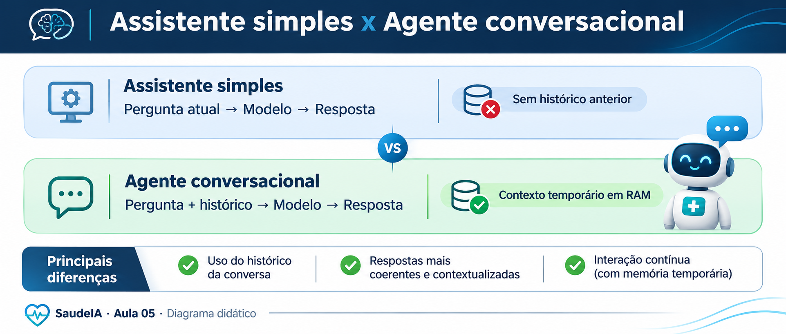
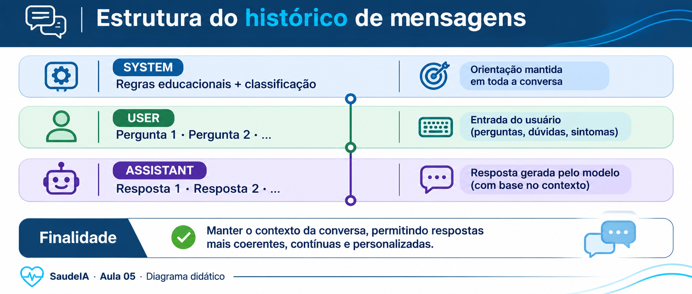
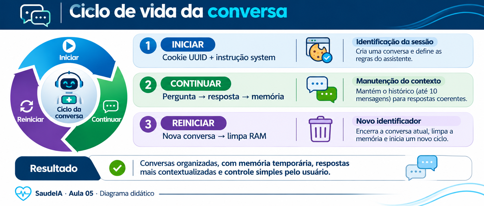
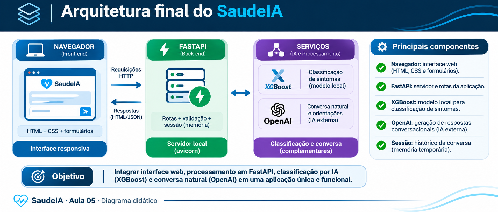

# Aula 05 — Aperfeiçoamento e Finalização do SaudeIA

**Disciplina:** Programação para Engenharia Mecânica · **Projeto:** SaudeIA  
**Ambiente:** Windows · VSCode · PowerShell · Python 3.12 · FastAPI · Jinja2 · XGBoost · OpenAI · pytest

> **Uso exclusivamente didático.** O SaudeIA não fornece diagnósticos médicos. Utilize somente descrições fictícias. A confiança do XGBoost não é uma probabilidade clínica validada.

## 1. Objetivos e ponto de partida

Esta aula **conclui o projeto didático**. Parte da **Aula 04**, sem reensinar treinamento, persistência e rotas básicas. A implementação final utiliza POST/Redirect/GET para impedir o reenvio involuntário de formulários ao atualizar a página. Ao final, teremos histórico de conversa visível, perguntas sucessivas dentro do próprio chat, reinício de sessão sem sair do painel, respostas educativas sobre tratamentos gerais, validações, testes e GitHub. **Não criaremos agente autônomo, banco de dados ou implantação em nuvem.**

### 1.1. Comparação das funcionalidades

| Critério                           | Converse com o Assistente (`/chat`) | Agente da Aula 04 (`/chat_agente`) | Agente final da Aula 05    |
| ---------------------------------- | ----------------------------------- | ---------------------------------- | -------------------------- |
| Modelo                             | `gpt-4o-mini`                       | `gpt-4o-mini`                      | `gpt-4o-mini`              |
| Recebe a classificação atual       | Sim                                 | Apenas na criação da sessão        | Sim; reinicia se mudar     |
| Recebe mensagens anteriores        | Não                                 | Sim                                | Sim                        |
| Exibe conversa completa            | Não                                 | Sim, na implementação atual        | **Sim**                    |
| Limita memória                     | Não aplicável                       | Sim, parcialmente                  | **Sim, dez mensagens**     |
| Permite nova conversa              | Não aplicável                       | Sim, na implementação atual        | **Sim, no próprio painel** |
| Mantém pergunta após falha externa | Não aplicável                       | Pode manter                        | **Não**                    |
| Usa ferramentas autônomas          | Não                                 | Não                                | **Não**                    |
| Memória após reiniciar servidor    | Não                                 | Não                                | **Não**                    |

O **Assistente simples** recebe uma pergunta isolada e a classificação do formulário. Mesmo que o usuário pergunte “Resuma o que você disse”, a resposta anterior **não está no payload** enviado ao modelo. Já o **Agente conversacional** envia uma lista com os papéis `system`, `user` e `assistant`, permitindo referências a mensagens anteriores. **Ter histórico não transforma, por si só, o chatbot em agente autônomo.**



_Figura 1 — Comparação entre uma requisição isolada e uma conversa com memória._

## 2. Como a memória funciona

A primeira mensagem, `system`, estabelece regras educacionais e a classificação experimental. Cada pergunta `user` e resposta `assistant` compõem o diálogo. Na Aula 05, preservamos a instrução e até dez mensagens recentes. Quando a classificação muda, iniciamos um contexto novo para não misturar casos fictícios.



_Figura 2 — Papéis de mensagem e reutilização de contexto._



_Figura 3 — Identificação por cookie, memória em RAM e reinício voluntário._

## 3. Preparar o ambiente

No terminal integrado do VSCode:

```powershell
cd C:\Projetos\SaudeIA
.\.venv\Scripts\Activate.ps1
git status
python -m pip install -r requirements.txt
```

Antes de substituir arquivos, confira se os serviços da Aula 03, os três artefatos do modelo e a chave de API (quando for testar conversas reais) estão disponíveis. O pacote desta aula inclui **os arquivos-fonte de exemplo**, mas **não inclui credenciais nem os modelos treinados**; caso necessário, gere-os conforme a Aula 03. Consulte a Aula 04 para revisar as rotas básicas.

## 4. Implementar o backend final

Abra `main_api.py` e **substitua todo o conteúdo** pelo código a seguir. Ele mantém as rotas de classificação, CSV, QR Code, Swagger e assistente simples, e amplia somente o gerenciamento da conversa. O código está comentado para explicar cada etapa.

### 4.1. Servidor FastAPI completo

A instrução `system` é atualizada a cada classificação; o histórico só é confirmado quando a API responde. O limite de dez mensagens evita crescimento ilimitado por conversa, mas não equivale a limitar tokens nem expira sessões antigas. O estado visual da página fica em `chat_views`, separado das mensagens guardadas em `chat_sessions`.

**Arquivo: `main_api.py` — código integral para copiar e colar.**

```python
"""SaudeIA: servidor FastAPI, inferência local e conversas com IA.

Este arquivo coordena a interface HTML, o classificador da Aula 03,
o histórico CSV, o QR Code e as rotas de comunicação externa.
"""
# Biblioteca padrão: escreve as classificações em uma tabela CSV.
import csv
# Registra a data e a hora de cada classificação.
from datetime import datetime
# Manipula caminhos de arquivos independentemente da pasta atual do terminal.
from pathlib import Path
# Descobre o endereço IPv4 da máquina para gerar o QR Code.
import socket
# Cria identificadores únicos para sessões de conversa.
import uuid

# Gera a imagem QR Code que aponta para o servidor na rede local.
import qrcode
# FastAPI define rotas; Form recebe formulários; Request representa a requisição.
# HTTPException devolve erros HTTP controlados, como 422.
from fastapi import FastAPI, Form, HTTPException, Request
# HTMLResponse identifica rotas que devolvem páginas HTML.
from fastapi.responses import HTMLResponse, RedirectResponse
# StaticFiles publica CSS, favicon e QR Code em /static.
from fastapi.staticfiles import StaticFiles
# Jinja2Templates renderiza index.html com valores enviados pelo Python.
from fastapi.templating import Jinja2Templates
# Cliente da API externa usado SOMENTE nas rotas de conversa.
from openai import OpenAI
# Pydantic descreve e valida os dados JSON de entrada e saída.
from pydantic import BaseModel, Field

# Reutiliza o classificador treinado e salvo na Aula 03 (sem API externa).
from services.diagnosticoIA import DiagnosticoIA
# Importa o serviço separado que conversa com o modelo de linguagem.
from services.agenteIA import AgenteSaudeIA

# __file__ aponta para este arquivo; .parent identifica a raiz do projeto.
BASE_DIR = Path(__file__).resolve().parent
# Caminhos absolutos evitam erros ao executar a aplicação em outro diretório.
STATIC_DIR = BASE_DIR / "static"
# Cria a pasta static se necessário, sem erro caso já exista.
STATIC_DIR.mkdir(exist_ok=True)
TEMPLATES_DIR = BASE_DIR / "templates"
HISTORICO = BASE_DIR / "historico.csv"

# A aplicação é criada uma única vez, antes dos decoradores de rotas.
app = FastAPI(title="SaudeIA", version="1.0")
# Faz /static/style.css e /static/qrcode.png ficarem acessíveis ao navegador.
app.mount("/static", StaticFiles(directory=str(STATIC_DIR)), name="static")
# Define onde estão as páginas HTML interpretadas pelo Jinja2.
templates = Jinja2Templates(directory=str(TEMPLATES_DIR))

# A classificação local usa os três arquivos persistidos na Aula 03.
# Instancia o classificador com os três artefatos já salvos; NÃO treina novamente.
ia = DiagnosticoIA(str(BASE_DIR / "model"))
# Armazenamento em RAM: demonstrativo, sem persistência entre reinícios.
chat_sessions: dict[str, list[dict[str, str]]] = {}
# Estado visual temporário associado à sessão, para a navegação POST/Redirect/GET.
chat_views: dict[str, dict[str, str]] = {}
MAX_MENSAGENS = 10  # Cinco pares pergunta/resposta, quando completos.
MAX_PERGUNTA = 1000


def descobrir_ip_local():
    """Descobre o IP IPv4 da rede; fallback para localhost se não houver rede."""
    try:
        # Um socket UDP permite identificar a interface de rede escolhida pelo SO.
        # connect() aqui não envia sintomas nem faz uma chamada à API da OpenAI.
        with socket.socket(socket.AF_INET, socket.SOCK_DGRAM) as conexao:
            conexao.connect(("8.8.8.8", 80))
            # Obtém o endereço local da interface de rede selecionada.
            return conexao.getsockname()[0]
    except OSError:
        # Fallback: acessível no computador, mas não necessariamente no celular.
        return "127.0.0.1"


def criar_qrcode():
    # O QR Code deve usar o IPv4 real, nunca 0.0.0.0.
    endereco = f"http://{descobrir_ip_local()}:8000"
    # O navegador poderá ler a imagem pela rota /static/qrcode.png.
    qrcode.make(endereco).save(STATIC_DIR / "qrcode.png")
    print("QR Code criado para:", endereco)


criar_qrcode()


def get_session_id(request: Request) -> str:
    """Recupera o identificador do navegador ou cria um UUID novo."""
    identificador = request.cookies.get("session_id", "")
    try:
        # Só aceita UUIDs válidos, evitando identificadores arbitrários.
        return str(uuid.UUID(identificador))
    except (ValueError, AttributeError, TypeError):
        return str(uuid.uuid4())


def instrucao_sistema(doenca: str) -> dict[str, str]:
    """Define limites e contexto educacional da conversa."""
    classificacao = doenca.strip()[:120] or "não informada"
    return {
        "role": "system",
        "content": (
            "Você é um assistente educacional sobre saúde. "
            "Explique didaticamente sintomas, exames, prevenção e opções gerais de tratamento. "
            "Ao perguntarem sobre tratamentos, descreva as abordagens habituais e seus objetivos. "
            "A classificação é experimental e NÃO é diagnóstico: não pressuponha que "
            "o usuário tenha a condição classificada. "
            "Não prescreva medicamentos, doses nem condutas individualizadas. "
            "Não solicite dados pessoais. Em situações urgentes, recomende atendimento médico. "
            f"Classificação experimental atual: {classificacao}."
        ),
    }


def limitar_historico(mensagens: list[dict[str, str]]) -> list[dict[str, str]]:
    """Preserva a instrução system e até dez mensagens recentes."""
    return [mensagens[0]] + mensagens[1:][-MAX_MENSAGENS:]


def mensagens_visiveis(mensagens: list[dict[str, str]]) -> list[dict[str, str]]:
    """Não apresenta a instrução interna system na interface."""
    return [m for m in mensagens if m["role"] in ("user", "assistant")]


def contexto_pagina(request: Request, **dados):
    """Renderiza a página mantendo os valores recebidos do backend."""
    return templates.TemplateResponse(request=request, name="index.html", context=dados)


# GET /: exibe a página inicial sem enviar dados para classificação.
@app.get("/", response_class=HTMLResponse)
async def home(request: Request):
    # Sintaxe atual do Starlette: request e name são argumentos nomeados.
    return templates.TemplateResponse(request=request, name="index.html")


# Compatibilidade de navegação: GET não deve executar operações de POST.
# O redirecionamento evita 405 em links ou histórico do navegador,
# mas não implementa PRG para os formulários antigos.
@app.get("/diagnosticar", include_in_schema=False)
@app.get("/chat", include_in_schema=False)
async def redirecionar_formularios_antigos():
    """Redireciona acessos GET às rotas de processamento para a página inicial."""
    return RedirectResponse(url="/", status_code=303)


# POST /diagnosticar: recebe o campo "sintomas" do formulário HTML.
@app.post("/diagnosticar", response_class=HTMLResponse)
async def diagnosticar(request: Request, sintomas: str = Form("")):
    # strip() retira espaços nas extremidades; split() separa as palavras.
    # O exemplo exige duas palavras para evitar entradas vazias ou muito curtas.
    if len(sintomas.strip().split()) < 2:
        # Devolve a mesma página, mas com uma mensagem de validação.
        return templates.TemplateResponse(
            request=request, name="index.html",
            context={"erro": "Digite pelo menos dois sintomas!", "sintomas": sintomas},
        )

    # prever() retorna (classe prevista, probabilidade entre 0 e 1).
    # A inferência acontece localmente, sem consumir créditos da OpenAI.
    doenca, prob = ia.prever(sintomas)
    # CSV histórico local: somente dados fictícios durante as aulas.
    # Se o CSV ainda não existe ou está vazio, será necessário criar o cabeçalho.
    arquivo_novo = not HISTORICO.exists() or HISTORICO.stat().st_size == 0
    # Modo "a" acrescenta uma linha sem apagar as classificações anteriores.
    with HISTORICO.open("a", newline="", encoding="utf-8") as arquivo:
        writer = csv.writer(arquivo)
        # Cabeçalho apenas na primeira gravação.
        if arquivo_novo:
            writer.writerow(["data", "sintomas", "doenca", "prob"])
        # Uma linha por classificação; use somente textos fictícios em aula.
        writer.writerow([datetime.now().isoformat(timespec="seconds"), sintomas, doenca, prob])

    # context leva os valores para {{ doenca }}, {{ prob }} e {{ sintomas }}.
    # Multiplicamos por 100 para mostrar a probabilidade em porcentagem.
    return templates.TemplateResponse(
        request=request, name="index.html",
        context={"doenca": doenca, "prob": round(float(prob) * 100, 2), "sintomas": sintomas},
    )


# Assistente simples: cada pergunta é enviada sem histórico de mensagens anteriores.
@app.post("/chat", response_class=HTMLResponse)
async def chat(request: Request, pergunta: str = Form(""), doenca: str = Form("")):
    if not pergunta.strip() or len(pergunta.strip()) > MAX_PERGUNTA:
        return contexto_pagina(request, doenca=doenca, erro="Informe uma pergunta de até 1000 caracteres.")
    # Prompt: instruções que contextualizam a pergunta enviada ao LLM.
    prompt = (
        "Você é um assistente educacional sobre saúde. "
        "Explique opções gerais de tratamento, prevenção e exames quando perguntado, "
        "sem prescrever doses ou condutas individualizadas. "
        "A classificação é experimental, não confirma diagnóstico. "
        "Oriente a procurar profissionais habilitados para decisões clínicas. "
        f"Classificação do sistema: {doenca}. Pergunta: {pergunta}"
    )
    try:
        # Criação tardia: sem chave, a classificação local continua disponível.
        cliente = OpenAI()
        # Esta linha faz uma chamada de rede que pode consumir créditos da API.
        resposta = cliente.chat.completions.create(
            model="gpt-4o-mini", messages=[{"role": "user", "content": prompt}]
        )
        # Extrai o conteúdo textual da primeira alternativa devolvida.
        texto = resposta.choices[0].message.content or "Sem resposta textual."
    except Exception as erro:
        # Não derruba o classificador local caso a API externa falhe.
        print("Falha no assistente:", type(erro).__name__, str(erro))
        texto = "⚠️ Assistente indisponível. Verifique a chave, a conexão e o faturamento da API."
    return templates.TemplateResponse(
        request=request, name="index.html",
        context={"doenca": doenca, "prob": "", "resposta": texto},
    )


# A rota GET é a única responsável por apresentar o histórico após um POST.
@app.get("/conversa", response_class=HTMLResponse)
async def ver_conversa(request: Request):
    """Mostra a conversa existente; atualizar esta URL nunca reenvia o POST."""
    session_id = get_session_id(request)
    estado = chat_views.get(session_id, {})
    historico = chat_sessions.get(session_id, [])
    pagina = contexto_pagina(
        request,
        doenca=estado.get("doenca", ""),
        historico_agente=mensagens_visiveis(historico),
        erro_agente=estado.get("erro_agente"),
        aviso_conversa=estado.get("aviso_conversa"),
    )
    pagina.set_cookie("session_id", session_id, httponly=True, samesite="lax")
    return pagina


# Compatibilidade com links antigos: GET não altera a memória.
@app.get("/chat_agente")
@app.get("/nova_conversa")
async def redirecionar_links_antigos():
    return RedirectResponse(url="/conversa#conversa-agente", status_code=303)


# POST processa e armazena; depois redireciona para GET /conversa.
@app.post("/chat_agente")
async def chat_agente(
    request: Request,
    pergunta: str = Form(""),
    doenca: str = Form(""),
):
    session_id = get_session_id(request)
    pergunta = pergunta.strip()
    doenca = doenca.strip()[:120]

    if session_id not in chat_sessions:
        chat_sessions[session_id] = [instrucao_sistema(doenca)]
    historico = chat_sessions[session_id]
    nova_instrucao = instrucao_sistema(doenca)
    if historico[0] != nova_instrucao:
        historico = [nova_instrucao]
        chat_sessions[session_id] = historico

    erro_agente = ""
    if not pergunta or len(pergunta) > MAX_PERGUNTA:
        erro_agente = f"Digite uma pergunta com 1 a {MAX_PERGUNTA} caracteres."
    else:
        tentativa = limitar_historico(historico + [{"role": "user", "content": pergunta}])
        try:
            resposta = AgenteSaudeIA().perguntar_chat(tentativa)
            if not isinstance(resposta, str) or not resposta.strip():
                raise ValueError("Resposta textual vazia")
            chat_sessions[session_id] = limitar_historico(
                tentativa + [{"role": "assistant", "content": resposta}]
            )
        except Exception as erro:
            print("Falha no agente:", type(erro).__name__)
            erro_agente = "Agente indisponível. Verifique conexão, chave e créditos da API."

    chat_views[session_id] = {"doenca": doenca, "erro_agente": erro_agente}
    pagina = RedirectResponse(url="/conversa#conversa-agente", status_code=303)
    pagina.set_cookie("session_id", session_id, httponly=True, samesite="lax")
    return pagina


@app.post("/nova_conversa")
async def nova_conversa(request: Request, doenca: str = Form("")):
    """Apaga o histórico anterior e inicia nova sessão sem sair do chat."""
    session_id = get_session_id(request)
    chat_sessions.pop(session_id, None)
    chat_views.pop(session_id, None)
    nova_sessao = str(uuid.uuid4())
    chat_views[nova_sessao] = {
        "doenca": doenca.strip()[:120],
        "aviso_conversa": "Nova conversa iniciada. Digite sua pergunta abaixo.",
    }
    pagina = RedirectResponse(url="/conversa#conversa-agente", status_code=303)
    pagina.set_cookie("session_id", nova_sessao, httponly=True, samesite="lax")
    return pagina


# Endpoint de saúde do SERVIDOR (não é avaliação clínica de saúde).
@app.get("/api/saude")
def api_saude():
    return {"status": "online", "servico": "SaudeIA"}


# Pydantic rejeita automaticamente JSON com texto ausente ou muito longo.
class EntradaPrevisao(BaseModel):
    # A validação de duas palavras também é feita na função api_prever().
    texto: str = Field(min_length=1, max_length=1000)


class SaidaPrevisao(BaseModel):
    """Esquema JSON mostrado no Swagger e devolvido ao cliente."""
    classe_prevista: str           # Rótulo devolvido pelo classificador.
    confianca_percentual: float    # Probabilidade estimada × 100 (não é acurácia).
    aviso: str                     # Alerta sobre a finalidade educacional.


# POST /api/prever: recebe JSON, não um formulário HTML.
# response_model determina o formato validado e documentado no Swagger.
@app.post("/api/prever", response_model=SaidaPrevisao)
def api_prever(entrada: EntradaPrevisao):
    # Remove espaços antes de validar e enviar o texto ao classificador.
    texto = entrada.texto.strip()
    if len(texto.split()) < 2:
        # Código HTTP 422 informa que o corpo JSON não passou na validação.
        raise HTTPException(status_code=422, detail="Informe pelo menos duas palavras.")
    # Mesmo classificador utilizado pelo formulário /diagnosticar.
    classe, prob = ia.prever(texto)
    return SaidaPrevisao(
        classe_prevista=classe,
        # Converte de escala 0–1 para percentual, com duas casas decimais.
        confianca_percentual=round(float(prob) * 100, 2),
        aviso="Classificação exclusivamente didática; não constitui diagnóstico médico.",
    )


# Permite iniciar com "python -m main_api"; o comando uvicorn é preferível na aula.
if __name__ == "__main__":
    import uvicorn
    # Execução local. Para acesso via QR Code, use o comando da Seção 9.
    uvicorn.run(app, host="127.0.0.1", port=8000)
```

### 4.2. Por que usar POST/Redirect/GET (PRG)?

Ao enviar uma pergunta, `POST /chat_agente` processa a mensagem, registra a resposta em memória e retorna **HTTP 303** com o endereço `/conversa#conversa-agente`. O navegador faz `GET /conversa`, que apresenta o histórico. O mesmo fluxo é aplicado ao botão **Nova conversa**. Assim, atualizar a página não repete o último POST. O cookie `session_id` identifica a sessão; `chat_sessions` guarda as mensagens e `chat_views` guarda os avisos e o contexto necessário à apresentação.

| Etapa | Requisição          | Resultado                                     |
| ----- | ------------------- | --------------------------------------------- |
| 1     | `POST /chat_agente` | Processa a pergunta e devolve HTTP 303        |
| 2     | `GET /conversa`     | Renderiza o histórico e o formulário          |
| 3     | Atualizar a página  | Repete somente o GET, sem reenviar a pergunta |

## 5. Interface final com histórico e perguntas sucessivas

A página mantém os formulários da Aula 04 e passa a exibir todas as mensagens recentes do agente, além de um botão **Nova conversa**. A saída textual do modelo é escapada automaticamente pelo Jinja2: **não utilize `|safe`**.

### 5.1. HTML completo — chat contínuo

O bloco `` apresenta a conversa em ordem. O HTML final foi alinhado às rotas atuais e ao fluxo PRG. O botão envia `POST /nova_conversa`, que devolve **HTTP 303**; o navegador segue para `GET /conversa`, mantendo o painel e a classificação experimental informada pelo campo oculto `doenca`. O teste de reinício deve enviar esse campo, assim como faz o formulário HTML.

**Arquivo: `templates/index.html` — código integral para copiar e colar.**

```html
<!doctype html>
<html lang="pt-BR">
  <head>
    <!-- Define o conjunto de caracteres, incluindo acentos. -->
    <meta charset="utf-8" />
    <!-- Ajusta a largura da página para celulares e tablets. -->
    <meta name="viewport" content="width=device-width, initial-scale=1.0" />
    <title>SaudeIA</title>

    <!-- CSS e favicon são servidos pela pasta static/ do FastAPI. -->
    <link rel="stylesheet" href="/static/style.css" />
    <link rel="icon" href="/static/favicon.ico" />
  </head>
  <body>
    <!-- Agrupa todo o conteúdo visual da aplicação. -->
    <main class="container">
      <h2>🩺 SaudeIA</h2>

      <!-- Jinja2: exibe o erro somente quando o backend envia 'erro'. -->
      
      <div class="resultado erro" role="alert">{{ erro }}</div>
      

      <!-- FORMULÁRIO DE CLASSIFICAÇÃO: POST /diagnosticar. -->
      <form action="/diagnosticar" method="post">
        <!-- O atributo name identifica o campo recebido por Form(). -->
        <label for="sintomas">Descrição fictícia dos sintomas</label>
        <textarea
          id="sintomas"
          name="sintomas"
          placeholder="Digite os sintomas fictícios..."
        >
{{ sintomas or '' }}</textarea
        >
        <button type="submit">Diagnosticar</button>
      </form>

      <!-- Link GET / limpa o formulário; evita um botão dentro de <a>. -->
      <a class="botao botao-secundario" href="/">Limpar</a>

      <!-- RESULTADO LOCAL: valores fornecidos por ia.prever(). -->
      
      <section class="resultado" aria-label="Resultado da classificação">
        <h3>🩺 Classificação experimental</h3>
        <h2>{{ doenca }}</h2>
        <!-- prob pode ser string vazia quando uma rota de chat renderiza a página. -->
        
        <p><strong>Confiança do classificador:</strong> {{ prob }} %</p>
        
        <p class="aviso-curto">
          Resultado didático; não constitui diagnóstico médico.
        </p>
      </section>
      

      <!-- Assistente simples: disponível após a classificação experimental. -->
      
      <hr />
      <!-- ASSISTENTE SIMPLES: cada pergunta é independente. -->
      <h3>💬 Converse com o Assistente</h3>
      <form action="/chat" method="post">
        <!-- Envia a classificação atual junto da pergunta. -->
        <input type="hidden" name="doenca" value="{{ doenca }}" />
        <label for="pergunta-simples">Pergunta ao assistente</label>
        <textarea
          id="pergunta-simples"
          name="pergunta"
          maxlength="1000"
          placeholder="Digite sua dúvida..."
          required
        ></textarea>
        <button type="submit">Perguntar (Simples)</button>
      </form>
      <!-- A rota /chat envia apenas a resposta atual como 'resposta'. -->
      
      <div class="resultado" aria-live="polite">{{ resposta }}</div>
       

      <!-- O chat continua visível após Nova conversa, mesmo sem classificação. -->
      
      <hr />
      <!-- CHAT CONTÍNUO: o histórico e a próxima pergunta ficam juntos. -->
      <section
        class="secao-agente"
        id="conversa-agente"
        aria-label="Agente de IA"
      >
        <h3>🤖 Agente de IA — Conversa contínua</h3>
        <p class="aviso-curto">
          Respostas educativas; classificação experimental não é diagnóstico.
        </p>
        
        <div class="resultado aviso-conversa" role="status">
          {{ aviso_conversa }}
        </div>
         
        <div class="resultado erro" role="alert">{{ erro_agente }}</div>
        
        <div
          class="chat-box"
          id="historico-agente"
          aria-label="Histórico da conversa"
          aria-live="polite"
        >
          <h3>Histórico da conversa</h3>
            
          <div class="chat-user">
            <strong>Você:</strong>
            <p>{{ mensagem.content }}</p>
          </div>
          
          <div class="chat-agent">
            <strong>Agente:</strong>
            <p>{{ mensagem.content }}</p>
          </div>
            
          <p class="chat-vazio">
            Faça a primeira pergunta para iniciar o diálogo.
          </p>
          
        </div>
        <!-- Formulário permanece visível abaixo das mensagens. -->
        <form action="/chat_agente" method="post" class="form-chat">
          <input type="hidden" name="doenca" value="{{ doenca }}" />
          <label for="pergunta-agente">Próxima pergunta ao agente</label>
          <textarea
            id="pergunta-agente"
            name="pergunta"
            maxlength="1000"
            rows="3"
            placeholder="Digite sua próxima pergunta..."
            required
          ></textarea>
          <button type="submit">Enviar pergunta</button>
        </form>
        <!-- Nova conversa não volta à página inicial. -->
        <form action="/nova_conversa" method="post" class="form-nova-conversa">
          <input type="hidden" name="doenca" value="{{ doenca }}" />
          <button type="submit" class="botao-nova-conversa">
            Nova conversa
          </button>
        </form>
      </section>
      <script>
        // Após renderizar, rola o histórico para a última mensagem.
        const historico = document.getElementById("historico-agente");
        if (historico) historico.scrollTop = historico.scrollHeight;
      </script>
      

      <!-- AVISO OBRIGATÓRIO SOBRE O CARÁTER EDUCACIONAL. -->
      <hr />
      <p class="aviso-legal">
        ⚠️ Este sistema é educacional e não substitui avaliação médica! Utilize
        somente dados fictícios.
      </p>

      <!-- QR Code gerado pelo backend para acesso na mesma rede local. -->
      <div class="qr-code">
        
        <p>Aponte a câmera do celular</p>
      </div>
    </main>
  </body>
</html>
```

### 5.2. CSS completo

Preservamos a aparência da Aula 04 e adicionamos estilos para quebra de linha, histórico e avisos.

**Arquivo: `static/style.css` — código integral para copiar e colar.**

```css
/* ==============================
   RESET BÁSICO
   Remove margens padrão e facilita o cálculo das larguras.
   ============================== */
* {
  box-sizing: border-box;
  margin: 0;
  padding: 0;
}

/* ==============================
   BODY: aparência geral da página.
   ============================== */
body {
  font-family: Arial, Helvetica, sans-serif;
  background: #f2f5f9;
  padding: 10px;
  color: #263238;
}

/* ==============================
   CONTAINER PRINCIPAL
   Limita a largura para facilitar a leitura.
   ============================== */
.container {
  max-width: 500px;
  width: 100%;
  margin: 40px auto;
  background: white;
  padding: 25px;
  border-radius: 12px;
  box-shadow: 0 0 10px rgba(0, 0, 0, 0.1);
}

/* Títulos e separadores das seções. */
h2 {
  text-align: center;
  margin-bottom: 20px;
}
h3 {
  margin-top: 20px;
  margin-bottom: 10px;
}
hr {
  margin-top: 20px;
  border: 0;
  border-top: 1px solid #dce3e9;
}
label {
  display: block;
  margin-top: 12px;
  font-size: 14px;
}

/* ==============================
   TEXTAREA: entrada de texto multilinha.
   ============================== */
textarea {
  width: 100%;
  min-height: 100px;
  padding: 10px;
  margin-top: 10px;
  border-radius: 6px;
  border: 1px solid #ccc;
  resize: vertical;
  font: inherit;
  font-size: 14px;
}

/* ==============================
   BOTÕES E LINK COM APARÊNCIA DE BOTÃO.
   ============================== */
button,
.botao {
  display: block;
  margin-top: 12px;
  width: 100%;
  padding: 10px;
  background: #0d6efd;
  color: white;
  border: none;
  border-radius: 6px;
  font-size: 14px;
  text-align: center;
  text-decoration: none;
  cursor: pointer;
}
button:hover,
.botao:hover {
  background: #0b5ed7;
}
.botao-secundario {
  background: #6c757d;
}
.botao-secundario:hover {
  background: #5a6268;
}

/* ==============================
   RESULTADO E AVISOS.
   ============================== */
.resultado {
  margin-top: 15px;
  padding: 12px;
  background: #e9ecef;
  border-radius: 6px;
  font-size: 14px;
  overflow-wrap: anywhere;
}
.resultado h2 {
  margin-top: 10px;
  margin-bottom: 10px;
}
.erro {
  color: #a61b1b;
}
.aviso-curto {
  margin-top: 10px;
  font-size: 12px;
  color: #555;
}

/* ==============================
   CHAT: diferencia visualmente usuário e agente.
   ============================== */
.chat-box {
  margin-top: 15px;
}
.chat-user {
  background: #e3f2fd;
  padding: 10px;
  margin: 6px 0;
  border-radius: 10px;
  font-size: 14px;
  overflow-wrap: anywhere;
  white-space: pre-wrap;
}
.chat-agent {
  background: #f1f8e9;
  padding: 10px;
  margin: 6px 0;
  border-radius: 10px;
  font-size: 14px;
  overflow-wrap: anywhere;
  white-space: pre-wrap;
}

/* ==============================
   AVISO LEGAL E QR CODE.
   ============================== */
.aviso-legal {
  margin-top: 20px;
  font-size: 12px;
  color: #666;
  text-align: center;
}
.qr-code {
  text-align: center;
  margin: 20px 0 15px;
}
.qr-code img,
img {
  max-width: 100%;
}
.qr-code p {
  font-size: 12px;
  margin-top: 6px;
}

/* ==============================
   RESPONSIVIDADE: ajustes para celulares.
   ============================== */
@media (max-width: 480px) {
  .container {
    margin: 20px auto;
    padding: 20px;
  }
  textarea {
    min-height: 90px;
  }
  button,
  .botao {
    font-size: 13px;
  }
}
/* AULA 05: mantém quebras de linha e evita transbordamento de mensagens. */
.chat-user,
.chat-agent {
  overflow-wrap: anywhere;
}
.chat-user p,
.chat-agent p {
  margin-top: 7px;
  white-space: pre-wrap;
}
/* Botão secundário separado do envio da pergunta. */
.form-nova-conversa {
  margin-top: 12px;
}
.botao-nova-conversa {
  background: #526273;
}
.botao-nova-conversa:hover {
  background: #394957;
}
/* Avisos de falha e de validação acessíveis. */
.resultado.erro {
  color: #8a251f;
  border-left: 4px solid #b9382e;
}

/* AULA 05: conversa contínua no mesmo painel. */
.secao-agente {
  margin-top: 20px;
}
.chat-box {
  max-height: 380px;
  overflow-y: auto;
  padding: 10px;
  border: 1px solid #dbe3eb;
  border-radius: 10px;
  background: #f8fafc;
}
.chat-user,
.chat-agent {
  margin-top: 10px;
  margin-bottom: 10px;
  padding: 14px;
  line-height: 1.5;
}
.chat-user {
  margin-left: 10%;
}
.chat-agent {
  margin-right: 10%;
}
.chat-vazio {
  color: #536476;
  font-size: 14px;
  padding: 12px;
}
.form-chat {
  margin-top: 12px;
}
.form-chat textarea {
  min-height: 70px;
}
.aviso-conversa {
  border-left: 4px solid #2d8a66;
}
@media (max-width: 480px) {
  .chat-user {
    margin-left: 5%;
  }
  .chat-agent {
    margin-right: 5%;
  }
}
```

### 5.3. Por que agora o agente responde sobre tratamentos?

A instrução `system` foi aprimorada para permitir **explicações gerais e didáticas** sobre opções habituais de tratamento, exames e prevenção. Ela continua proibindo **prescrições individualizadas e doses**, pois o resultado do classificador não é diagnóstico clínico. O usuário pode perguntar novamente no formulário logo abaixo do histórico, sem voltar ao início da página.

O botão **Nova conversa** apaga a memória da sessão, cria outro identificador e redireciona para a página de conversa, mantendo o painel de chat e a classificação experimental exibida. O redirecionamento aponta para `/conversa#conversa-agente`, posicionando o navegador na área de conversa após o envio. As mensagens continuam escapadas pelo Jinja2; **não use `|safe`**.

## 6. Testes de funcionamento e segurança

Os testes a seguir **substituem a chamada à OpenAI por uma função simulada** (`monkeypatch`): nenhum deles consome créditos externos. Os testes HTTP dependem de importar o backend, que carrega os três modelos locais da Aula 03. Execute primeiro os testes e depois abra o navegador.

### 6.1. Testes completos

Verificamos limite do histórico, memória entre perguntas, mudança de classificação, reinício com e sem classificação, falha externa, validação de pergunta, escape de HTML e o redirecionamento POST/Redirect/GET (PRG).

**Arquivo: `tests/test_conversas.py` — código integral para copiar e colar.**

```python
"""Aula 05: valida memória e interface sem chamar a API OpenAI."""
from fastapi.testclient import TestClient
import main_api


def test_limite_e_instrucao():
    mensagens = [main_api.instrucao_sistema("Exemplo")]
    mensagens += [{"role": "user", "content": str(i)} for i in range(20)]
    resultado = main_api.limitar_historico(mensagens)
    assert resultado[0]["role"] == "system"
    assert len(resultado) == 11
    assert resultado[-1]["content"] == "19"


def test_dialogo_reutiliza_contexto(monkeypatch):
    chamadas = []

    def simular(self, mensagens):
        chamadas.append([m.copy() for m in mensagens])
        return "Resposta didática simulada"

    monkeypatch.setattr(main_api.AgenteSaudeIA, "perguntar_chat", simular)
    with TestClient(main_api.app) as cliente:
        r1 = cliente.post("/chat_agente", data={"pergunta": "Primeira pergunta", "doenca": "Exemplo"})
        r2 = cliente.post("/chat_agente", data={"pergunta": "Resuma sua resposta", "doenca": "Exemplo"})
        sessao = cliente.cookies.get("session_id")
    assert r1.status_code == r2.status_code == 200
    assert "Histórico da conversa" in r2.text
    assert "Primeira pergunta" in r2.text
    assert "Resuma sua resposta" in r2.text
    assert any(m["role"] == "assistant" for m in chamadas[1])
    main_api.chat_sessions.pop(sessao, None)


def test_contexto_diferente_inicia_nova_conversa(monkeypatch):
    monkeypatch.setattr(main_api.AgenteSaudeIA, "perguntar_chat", lambda self, m: "Simulação")
    with TestClient(main_api.app) as cliente:
        cliente.post("/chat_agente", data={"pergunta": "Pergunta A", "doenca": "Classe A"})
        r = cliente.post("/chat_agente", data={"pergunta": "Pergunta B", "doenca": "Classe B"})
        sessao = cliente.cookies.get("session_id")
    assert "Pergunta A" not in r.text
    assert "Pergunta B" in r.text
    assert "Classe B" in main_api.chat_sessions[sessao][0]["content"]
    main_api.chat_sessions.pop(sessao, None)


def test_nova_conversa_apaga_memoria(monkeypatch):
    """Reiniciar apaga a sessão anterior, cria outra e mantém o chat na página."""
    monkeypatch.setattr(main_api.AgenteSaudeIA, "perguntar_chat", lambda self, m: "Simulação")
    with TestClient(main_api.app) as cliente:
        cliente.post("/chat_agente", data={"pergunta": "Teste", "doenca": "Exemplo"})
        sessao_anterior = cliente.cookies.get("session_id")
        assert sessao_anterior in main_api.chat_sessions
        resposta = cliente.post("/nova_conversa", data={"doenca": "Exemplo"})
        assert resposta.status_code == 200
        assert "Nova conversa iniciada" in resposta.text
        assert "Próxima pergunta ao agente" in resposta.text
        assert "Teste" not in resposta.text
        assert sessao_anterior not in main_api.chat_sessions
        nova_sessao = cliente.cookies.get("session_id")
        assert nova_sessao is not None and nova_sessao != sessao_anterior


def test_nova_conversa_sem_classificacao_exibe_painel(monkeypatch):
    """Mesmo um POST direto sem campo doenca não deve esconder o chat."""
    with TestClient(main_api.app) as cliente:
        resposta = cliente.post("/nova_conversa")
    assert resposta.status_code == 200
    assert "Nova conversa iniciada" in resposta.text
    assert "Próxima pergunta ao agente" in resposta.text


def test_falha_nao_registra_pergunta(monkeypatch):
    def falhar(self, mensagens):
        raise RuntimeError("falha simulada")

    monkeypatch.setattr(main_api.AgenteSaudeIA, "perguntar_chat", falhar)
    with TestClient(main_api.app) as cliente:
        resposta = cliente.post("/chat_agente", data={"pergunta": "Falhou", "doenca": "Exemplo"})
        sessao = cliente.cookies.get("session_id")
    assert resposta.status_code == 200
    assert "Agente indisponível" in resposta.text
    assert all(m["content"] != "Falhou" for m in main_api.chat_sessions[sessao])
    main_api.chat_sessions.pop(sessao, None)


def test_validacao_pergunta_vazia_nao_chama_api(monkeypatch):
    def nao_chamar(self, mensagens):
        raise AssertionError("Não deveria consultar API")

    monkeypatch.setattr(main_api.AgenteSaudeIA, "perguntar_chat", nao_chamar)
    with TestClient(main_api.app) as cliente:
        resposta = cliente.post("/chat_agente", data={"pergunta": "   ", "doenca": "Exemplo"})
        sessao = cliente.cookies.get("session_id")
    assert resposta.status_code == 200
    assert "Digite uma pergunta" in resposta.text
    main_api.chat_sessions.pop(sessao, None)


def test_html_escapa_conteudo_do_modelo(monkeypatch):
    monkeypatch.setattr(main_api.AgenteSaudeIA, "perguntar_chat", lambda self, m: "<script>alert(1)</script>")
    with TestClient(main_api.app) as cliente:
        resposta = cliente.post("/chat_agente", data={"pergunta": "Teste", "doenca": "Exemplo"})
        sessao = cliente.cookies.get("session_id")
    assert "&lt;script&gt;" in resposta.text
    assert "<script>alert(1)</script>" not in resposta.text
    main_api.chat_sessions.pop(sessao, None)


def test_pergunta_seguinte_no_mesmo_painel(monkeypatch):
    """O usuário continua perguntando dentro do histórico, sem retornar ao topo."""
    monkeypatch.setattr(main_api.AgenteSaudeIA, "perguntar_chat", lambda self, m: "Resposta simulada")
    with TestClient(main_api.app) as cliente:
        resposta = cliente.post("/chat_agente", data={"pergunta": "Como funciona?", "doenca": "Exemplo"})
        sessao = cliente.cookies.get("session_id")
    assert resposta.status_code == 200
    assert 'action="/chat_agente"' in resposta.text
    assert 'action="/nova_conversa"' in resposta.text
    assert "Como funciona?" in resposta.text
    assert "Resposta simulada" in resposta.text
    main_api.chat_sessions.pop(sessao, None)


def test_instrucao_permite_explicacoes_gerais():
    """Não confunde educação sobre tratamento com prescrição individual."""
    instrucao = main_api.instrucao_sistema("Exemplo")["content"]
    assert "opções gerais de tratamento" in instrucao
    assert "Não prescreva" in instrucao


def test_prg_post_redireciona_para_get_sem_reenviar(monkeypatch):
    """O POST devolve 303; atualizar GET não repete a chamada ao agente."""
    chamadas = []
    def simular(self, mensagens):
        chamadas.append(mensagens)
        return "Resposta PRG"
    monkeypatch.setattr(main_api.AgenteSaudeIA, "perguntar_chat", simular)
    with TestClient(main_api.app) as cliente:
        resposta = cliente.post("/chat_agente", data={"pergunta": "Uma pergunta", "doenca": "Exemplo"}, follow_redirects=False)
        assert resposta.status_code == 303
        assert resposta.headers["location"] == "/conversa#conversa-agente"
        pagina = cliente.get("/conversa")
        assert pagina.status_code == 200
        assert "Uma pergunta" in pagina.text
        assert "Resposta PRG" in pagina.text
        cliente.get("/conversa")
        assert len(chamadas) == 1
        sessao = cliente.cookies.get("session_id")
    main_api.chat_sessions.pop(sessao, None)
    main_api.chat_views.pop(sessao, None)


def test_prg_nova_conversa_redireciona_e_preserva_aviso():
    with TestClient(main_api.app) as cliente:
        resposta = cliente.post("/nova_conversa", data={"doenca": "Exemplo"}, follow_redirects=False)
        assert resposta.status_code == 303
        pagina = cliente.get("/conversa")
        assert "Nova conversa iniciada" in pagina.text
        assert "Próxima pergunta ao agente" in pagina.text
        sessao = cliente.cookies.get("session_id")
    main_api.chat_views.pop(sessao, None)


def test_get_em_rotas_antigas_nao_retorna_405():
    with TestClient(main_api.app) as cliente:
        for rota in ("/chat_agente", "/nova_conversa"):
            resposta = cliente.get(rota, follow_redirects=False)
            assert resposta.status_code == 303
            assert resposta.headers["location"].startswith("/conversa")
```

### 6.2. Criar o arquivo e executar os testes

No PowerShell, dentro de `C:\Projetos\SaudeIA`:

```powershell
New-Item -ItemType Directory -Path tests -Force
New-Item -ItemType File -Path tests\test_conversas.py -Force
code tests\test_conversas.py
```

Copie o código completo acima, salve e execute:

```powershell
python -m pytest -q tests/test_conversas.py
python -m pytest -q tests/test_api.py
# Antes de rodar a suíte inteira, confira os módulos das aulas anteriores:
Get-ChildItem .\services -Name
python -m pytest -q tests/
# Inicie o servidor somente após terminar a execução dos testes:
python -m uvicorn main_api:app --reload --host 127.0.0.1 --port 8000
```

Abra `http://127.0.0.1:8000`. Experimente, **somente com dados fictícios**, classificar um texto, enviar duas perguntas relacionadas ao agente, observar o histórico e clicar em **Nova conversa**. Em seguida, compare com o **Assistente simples**, que não recebe respostas anteriores.

### 6.3. Verificações adicionais

1. Uma pergunta vazia ou com mais de mil caracteres deve mostrar aviso sem chamar a OpenAI.
2. Se a API falhar, a pergunta não deve ser registrada sem resposta.
3. Uma classificação diferente deve iniciar um novo contexto de diálogo.
4. A rota `/api/saude` deve continuar respondendo e `/docs` deve exibir a API.
5. O QR Code permite acesso pela mesma rede **quando o servidor é iniciado em `0.0.0.0`** e o firewall permite; a imagem deve conter o IP da máquina, não `0.0.0.0`.



_Figura 4 — Integração entre navegador, FastAPI, modelo local e serviço externo._

## 7. Qualidade, privacidade e limitações

**O que foi concluído:** interface responsiva básica, validações de formulário, tratamento de falha externa, histórico limitado por sessão, reinício voluntário, testes e organização dos arquivos.

**O que permanece como limitação:** o histórico fica apenas na RAM, não tem prazo de expiração nem autenticação, não é compartilhado entre múltiplos processos e desaparece ao reiniciar o servidor. O campo oculto `doenca` vem do navegador e não é prova de uma classificação validada. O cookie não substitui autenticação. Não coloque a aplicação diretamente na internet sem endurecimento de segurança e revisão de privacidade. Não registre dados reais de pacientes.

O arquivo `.env` e os artefatos de modelos ficam fora do repositório; nunca publique a chave da API. Os testes de conversa são simulados, mas perguntas reais feitas no navegador usam um serviço externo e podem gerar custos.

## 8. Git e GitHub — concluir o projeto

Salve esta aula em `aulas/aula-05-aperfeicoamento-finalizacao-saudeia.md` e os diagramas em `assets/`. Depois:

```powershell
git status
git diff --check
python -m pytest -q
git add main_api.py templates/index.html static/style.css
git add tests/test_conversas.py
git add aulas/aula-05-aperfeicoamento-finalizacao-saudeia.md
git add assets/diagramas/01-assistente-versus-agente.png
git add assets/diagramas/02-mensagens-e-memoria.png
git add assets/diagramas/04-arquitetura-final.png
git add assets/fluxogramas/03-ciclo-de-conversa.png
git status
git commit -m "Aula 05: finalizar interface memoria e testes do SaudeIA"
git push origin main
```

Antes de `git add`, confira se `.env`, `historico.csv`, `model/` e arquivos temporários não serão enviados. Inclua no README do projeto instruções de instalação, execução, testes, objetivo didático e limitações. O pacote desta aula contém os códigos de referência e os diagramas, mas não substitui o treinamento da Aula 03.

## 9. Checklist de encerramento

- [ ] Consigo explicar por que o assistente simples não possui memória de diálogo.
- [ ] O agente mostra o histórico e permite iniciar nova conversa.
- [ ] O sistema preserva o classificador e as rotas da Aula 04.
- [ ] A classificação experimental não é apresentada como diagnóstico médico.
- [ ] Executei os testes sem chamadas reais à OpenAI.
- [ ] Conferi o `.gitignore` e publiquei apenas arquivos apropriados.
- [ ] O projeto possui documentação de instalação e execução.

---

© 2026 **Wilson Luciano** · Programação para Engenharia Mecânica · DMEC · UFS · SaudeIA — Inteligência Artificial Aplicada à Engenharia · Material didático · Versão 1.0
